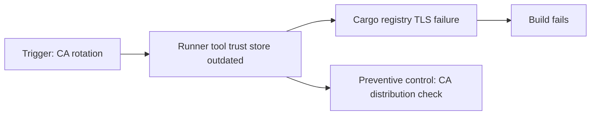

# Root-cause analysis and prevention

An incident is not resolved merely because a retry succeeds. Reliable root-cause analysis explains the causal chain from triggering condition to observed failure, identifies why controls did not prevent it, and establishes evidence that the correction works. This is especially important in enterprise CI where transient outages, runner drift and policy changes can look identical from the pipeline overview.

## Causal analysis

The trigger is not necessarily the root cause. A CA rotation may be expected; the underlying weakness is that managed runner tool trust stores were not updated or validated. Distinguish immediate cause, systemic contributing factors and observable consequences.

## RCA record

| Field | Example |
|---|---|
| Impact | Windows Rust builds blocked on protected branch |
| Trigger | Enterprise proxy CA updated |
| Earliest failure | Cargo registry TLS handshake |
| Evidence | Client error, certificate chain, host inventory |
| Root cause | Cargo trust configuration omitted from CA rollout |
| Immediate remediation | Install approved CA for affected client |
| Prevention | Automated post-rotation connectivity checks |
| Verification | Same locked build succeeds on affected runner |

## Five-whys limitations

Repeatedly asking “why” can expose a causal chain, but should not substitute for evidence. Incidents often have multiple contributing factors: a runner lacks a CA update, monitoring misses the failure, and release procedures depend on a single host. A single linear narrative can hide these parallel causes.

## Distinguish remediation types

**Containment** reduces immediate impact (for example, pausing a compromised runner). **Workaround** restores service temporarily (moving a build to an approved alternative host). **Correction** removes the specific fault (updating a trust store). **Prevention** improves controls (automated configuration verification). Each has different completion criteria and ownership.

## Regression verification

Retest under the same commit, runner context, branch protection, tool versions and network path where possible. A build passing on a developer's laptop is weak evidence that a Windows service-account failure is fixed. For intermittent failures, repeat bounded trials and inspect whether the triggering condition remains present.

## Preventive controls by layer

| Layer | Useful control |
|---|---|
| GitLab YAML | Lint and scenario review for rules/needs |
| Runner | Configuration inventory and service health |
| Cargo | Pinned toolchain and `--locked` builds |
| Cache | Cold-build correctness checks |
| Scanners | Explicit submission and gate status checks |
| Security | Token rotation tests and least privilege |
| Network | Certificate and proxy change validation |

## Knowledge synchronization

Capture recurring failure signatures in the handbook, with affected versions and evidence. Update troubleshooting decision trees only after verification. Separate environment-specific endpoints and credentials from reusable conceptual guidance. Keep incident examples sanitized.

**Conclusion:** RCA should produce both a defensible explanation and a measurable reduction in recurrence risk.
