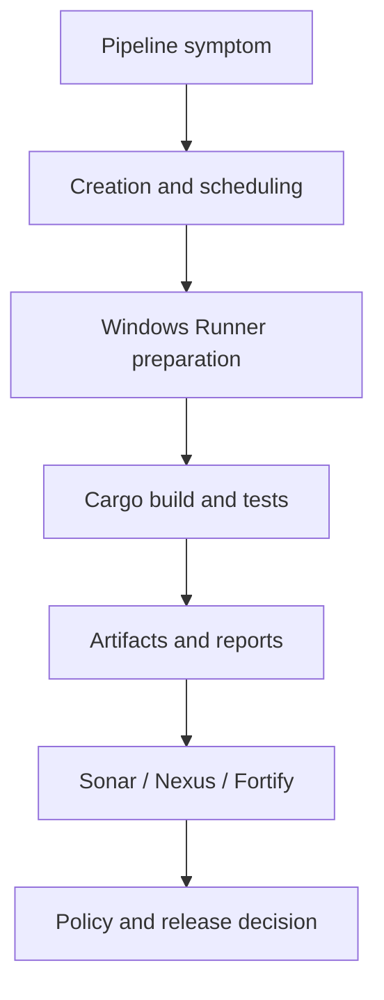

# P12 conclusions and troubleshooting competency

P12 connects the earlier phases into one diagnostic discipline. GitLab creates and schedules work; Windows Runner prepares and executes it; Cargo compiles and tests; caches optimize repeated work; artifacts transfer outputs; SonarQube, Nexus IQ and Fortify contribute distinct evidence; network, identity and policy controls govern every boundary. A failed pipeline can originate in any one of these systems.

## Unified incident map

This diagram is a diagnostic order, not necessarily the pipeline's exact DAG. Scanners may execute in parallel and may evaluate source or dependencies without waiting for a final executable.

## Competency rubric

| Level | Expected capability | Evidence |
|---|---|---|
| L1 Understand | Explain component ownership and failure boundaries | Correct classification of symptoms |
| L2 Modify | Propose a bounded configuration correction | YAML/TOML/PowerShell review with tradeoffs |
| L3 Troubleshoot | Prove a root cause and verification plan | Timeline, hypotheses, discriminating checks |

## L1 checklist

- [ ] Separate pipeline creation, runner assignment and job execution.
- [ ] Explain the difference between cache misses and missing artifacts.
- [ ] Distinguish Cargo compile errors from linker errors.
- [ ] Identify scanner submission versus server processing.
- [ ] Explain why SonarQube, Nexus IQ and Fortify findings are not interchangeable.

## L2 checklist

- [ ] Review `rules` and `needs` for missing or impossible jobs.
- [ ] Check Windows PowerShell environment and native exit codes.
- [ ] Propose project-relative Cargo cache paths and artifact transfer.
- [ ] Identify protected variable scope without revealing values.
- [ ] Describe a secure response to a TLS trust failure.

## L3 checklist

- [ ] Build a timestamped evidence timeline from multiple sources.
- [ ] Identify the earliest fatal failure and later cascading symptoms.
- [ ] Maintain at least two plausible hypotheses until evidence discriminates.
- [ ] Separate containment, workaround, correction and prevention.
- [ ] Verify the correction under equivalent execution conditions.

## Three capstone investigations

**Case 1 — No job starts.** A merge-request pipeline is visible, but the Windows build job is absent. Investigate job inclusion rules before runner availability. If the job exists and is pending, compare scope, tags, protection and concurrency. Do not restart the service without evidence.

**Case 2 — Windows-only Cargo failure.** Git checkout succeeds, cache restore misses, then the linker fails. Verify Rust target triple, MSVC/Windows SDK installation, service identity and host drift. Treat the cache miss as optional unless evidence shows a correctness dependency.

**Case 3 — Green scan, blocked release.** A scanner upload succeeds, but SonarQube or Nexus IQ reports a policy failure. Distinguish transport success from analysis completion and policy acceptance. Investigate the actual finding or gate condition; do not disable the gate to force a green pipeline.

## Operating rules

Capture exact commit and job identifiers, sanitize evidence, avoid logging secrets, never bypass TLS verification, and do not broaden runner privileges as a shortcut. Record what remains unknown. Prefer small, reversible changes with clear rollback and verification criteria.

## Relationship to P13

P13 Enterprise Readiness evaluates whether the knowledge from P0–P12 is coherent and operationally applicable. It should test reasoning across technology boundaries rather than rote recall of YAML keywords. The strongest evidence of readiness is the ability to explain *why* a pipeline failed and *which component owns the correction*.

**Final principle:** troubleshoot from the earliest observable boundary, prove the cause with evidence, and turn each verified fix into a durable control.
