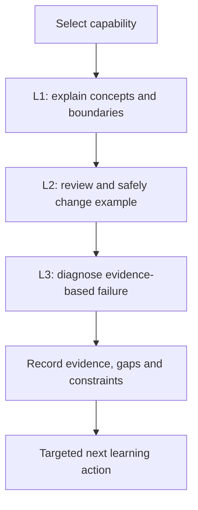

# Enterprise competency model

## Purpose and scope
Enterprise readiness is not the ability to recite tool names. It is the ability to explain a system, review and safely change its configuration, and investigate failures using evidence. The handbook uses three competency levels: **L1 Understand**, **L2 Modify**, and **L3 Troubleshoot**. They are evaluation levels rather than separate sets of technologies. A person can reach L3 for GitLab job scheduling while remaining L1 for Fortify integration; readiness should therefore be assessed per capability.

## Competency dimensions
| Dimension | L1: understand | L2: modify | L3: troubleshoot |
|---|---|---|---|
| Rust/Cargo | Explain crates, lockfiles, targets | Review features, profiles, commands | Isolate toolchain/dependency failures |
| GitLab CI | Explain job graph and rules | Change YAML without breaking dependencies | Diagnose skipped, pending, failed jobs |
| Windows Runner | Explain service/executor boundaries | Review tags, shell, paths | Trace service-account, TLS, PATH failures |
| Security tools | Distinguish Sonar, Nexus IQ, Fortify | Review scanner inputs and policy checks | Separate scanner, server, gate failures |
| Governance | Explain permissions and trust | Choose safe variable and artifact handling | Investigate leaks, unsafe overrides |

## Evidence-based scoring
Use four outcomes for each criterion: **Verified**, **Partially demonstrated**, **Unknown**, and **Not applicable**. Verified requires a concrete explanation or correctly reviewed example, not confidence alone. Unknown is not equivalent to failed; it identifies missing evidence. A configuration that is plausible but has never been run can demonstrate L2 *design competence*, not operational validation.

## Practical assessment protocol
Present a scenario with a source excerpt, YAML fragment, runner settings and sanitized error log. Ask for the expected flow, a minimal change, and a diagnostic hypothesis. Evaluate each independently. For example, someone may know `tags` syntax but incorrectly assume tags install Cargo. That is a conceptual gap; no amount of YAML memorization resolves it.

## Guardrails
Do not give an overall “enterprise ready” label merely because all chapters have been read. Document the intended job role and its boundaries. A developer maintaining `.gitlab-ci.yml` needs different authority from a platform engineer administering Windows services. Keep unverified assumptions explicit, especially where Fortify Rust support or SonarQube features vary by edition.

## Review checkpoint
Can the candidate explain why a successful scanner upload is not the same as a passing quality gate, and why a runner online status is not proof that a job is eligible? These distinctions demonstrate cross-component understanding rather than isolated tool familiarity.

**Outcome:** A role-specific, evidence-backed competency profile with traceable gaps.
