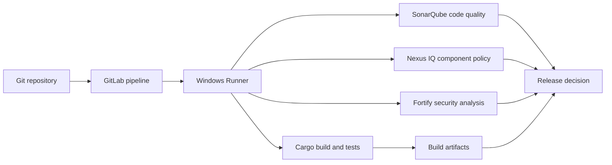

# Conceptual knowledge synthesis

## One system, several independent control planes
The pipeline comprises source and build semantics (Rust/Cargo), scheduling semantics (GitLab), execution semantics (Windows Runner), data movement (cache/artifacts), and assurance services (SonarQube, Nexus IQ, Fortify). Each answers a different question. Combining them does not remove their boundaries.

## Important pairs
| Often confused | Correct separation |
|---|---|
| Cargo.lock / cache key | Lockfile constrains resolution; cache key selects optional reuse |
| GitLab tags / runner capabilities | Tags influence eligibility; installed software determines capabilities |
| Protected variable / safe execution | Variable protection controls availability; malicious scripts may still exfiltrate accessible values |
| Artifact / registry package | Artifact is pipeline output; registry provides durable versioned distribution |
| Quality profile / gate | Profile activates rules; gate evaluates acceptance conditions |
| SAST / SCA | Source weakness analysis versus third-party component risk |
| Successful job / accepted release | A job may succeed while required external decisions remain unresolved |

## Java-to-Rust transfer
Java experience helps when reasoning about dependency management, build outputs and CI execution. Cargo resembles Maven in being a build and dependency tool, but `Cargo.lock`, features, targets, rustup and compiler behavior require Rust-specific understanding. Rust's ownership model improves memory safety; it does not eliminate authorization bugs, supply-chain vulnerabilities or insecure configuration. Do not substitute Java conventions for Rust evidence.

## End-to-end invariant
The output used for release must correspond to the same source revision and approved build configuration as the evidence used to authorize it. A scanner result from another commit, an artifact fetched from an unrelated pipeline, or a cached binary assumed to be authoritative violates that invariant. Record commit SHA, pipeline ID, artifact identity and scanner evaluation context.

## Synthesis case
A Rust build passes, Nexus IQ reports a license policy violation, SonarQube shows no new code issues, and Fortify analysis has not completed. A technically successful compilation is not an approved release. The release decision depends on the defined policy and whether all mandatory evidence is present. The correct response is not to turn all tools into a single green/red job without preserving their separate results.

**Outcome:** Explain how independent evidence streams converge without losing provenance or ownership.
