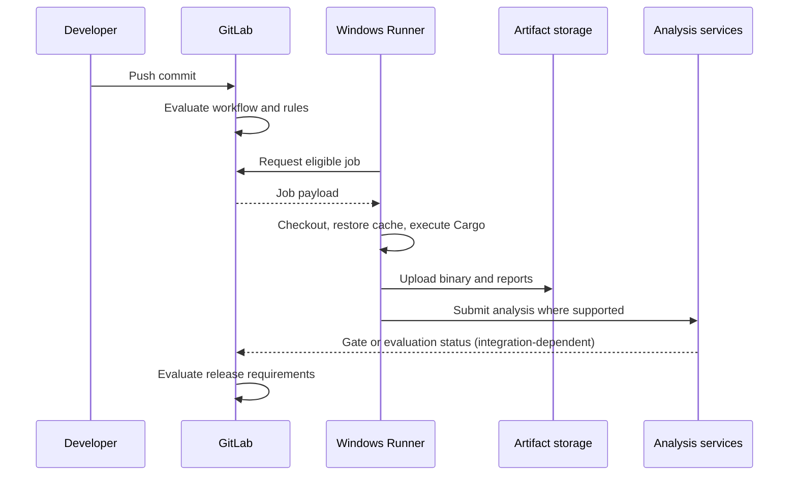

# Architecture and flow validation

## Validate boundaries before details
An architecture diagram is useful only when its connections correspond to real contracts. For this roadmap, validate who creates a job, who executes it, how inputs arrive, where outputs go, and which system decides acceptance. Explicitly distinguish **control flow** from **data flow**.

## Validation checklist
1. **Trigger:** Which ref, merge request, schedule or manual action creates the pipeline? A job absent due to `rules` is not a runner outage.
2. **Eligibility:** Do runner scope, tags, protection and capacity allow assignment?
3. **Identity:** Which Windows service account executes PowerShell and what can it access?
4. **Inputs:** Are lockfile, source revision, secrets and scanner reports available in the expected context?
5. **Handoff:** Are binaries and reports passed by declared artifacts rather than host-local assumptions?
6. **Decisions:** Are mandatory gates explicitly enforced, including timeout and unavailable-service behavior?

## Architecture review matrix
| Connection | Contract | Evidence |
|---|---|---|
| GitLab → Runner | Authenticated eligible job assignment | Job trace and runner metadata |
| Runner → Cargo | Installed compatible toolchain and filesystem access | Version and command logs |
| Test → Analysis | Supported report format and matching source paths | Artifact and import logs |
| Scanner → Server | Valid token, URL, TLS and supported product | Submission/task status |
| Gate → Release | Defined policy and explicit enforcement | Status check and release rules |

## Common diagram errors
Drawing GitLab as executing PowerShell directly hides the runner. Drawing all scanners as native Rust analyzers ignores product-specific support. Drawing a cache as a required input makes performance storage a correctness dependency. Drawing a green scanner job as a release approval hides asynchronous gate evaluation.

## Architecture acceptance
A valid design should be reviewable without a live environment: it must name each owner, dependency, trust boundary and failure behavior. A live test later verifies the assumptions; it does not replace the need to articulate them.

**Outcome:** A defensible flow model that supports configuration review and incident triage.
