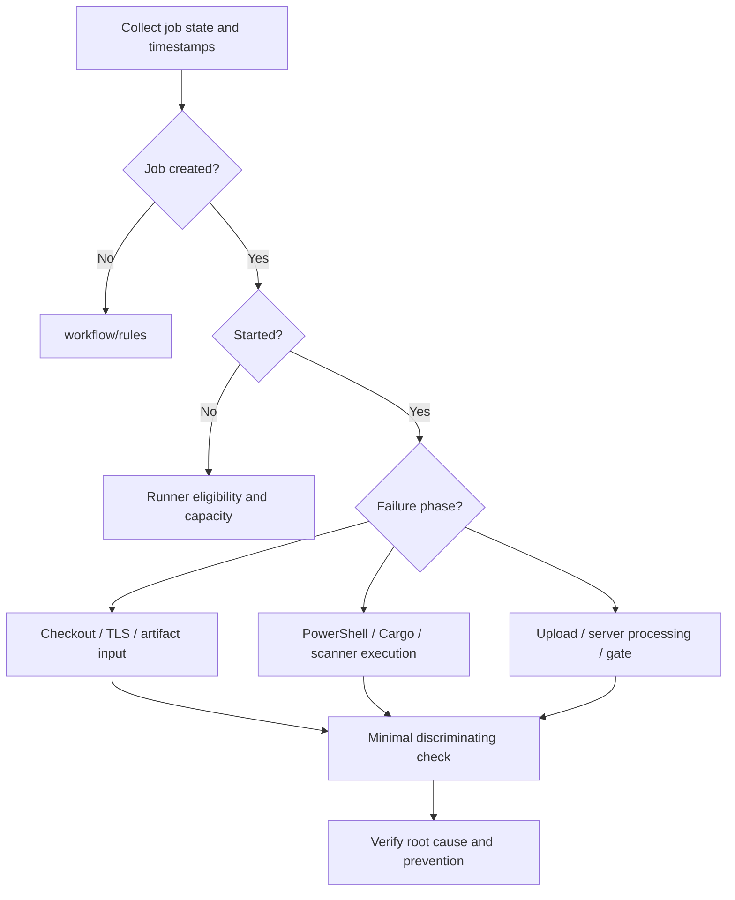

# Troubleshooting competency

## Find the earliest violated contract
Enterprise troubleshooting starts with **where the lifecycle stopped**, not with the most visible error message. A cache miss may be incidental; a scanner 403 may be a permission problem; a pending job cannot be fixed by changing Cargo flags. Separate observation, hypothesis, test and conclusion.

## Evidence hierarchy
Prefer exact job status, first fatal error, resolved runner identity, sanitized tool version, command exit code and relevant server response. Avoid full environment dumps or unredacted tokens. A successful manual command in an administrator's shell is weaker evidence than the same command under the runner service identity.

## Diagnostic cases
| Symptom | Competing hypotheses | First discriminating check |
|---|---|---|
| Job pending | Tags, scope, protection, capacity | Job requirements vs runner metadata |
| `cargo` not found | PATH, account, installation | Service identity and `Get-Command cargo` |
| Missing artifact | Wrong path, upload failure, expiry | Producer job artifact log |
| Scanner 401/403 | Token absent, wrong scope, project | Sanitized HTTP response and variable availability |
| TLS error in Cargo only | Tool-specific trust/proxy | Cargo endpoint and certificate chain |
| Green CI, red quality gate | No gate wait/enforcement | Gate status and CI integration configuration |

## Root-cause discipline
A workaround is not proof. Disabling TLS validation may make an upload work but introduces a security defect and does not establish which certificate or proxy was wrong. Clearing caches can temporarily fix a build without identifying incompatible key design. Require a repeatable causal explanation and a regression-prevention measure.

## Severity and ownership
Distinguish developer-owned YAML defects from platform-owned runner outages and security-owned policy failures. Record incident impact, affected pipelines, change history, containment and verification. Escalate with evidence and a bounded question rather than a large log dump.

## Assessment
Given a sanitized trace, ask the candidate to identify the earliest fatal stage, rank two plausible causes, propose one low-risk check, and describe what result would falsify the leading hypothesis.

**Outcome:** A falsifiable, evidence-driven diagnosis with a preventive action.
