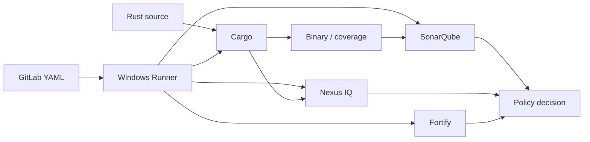

# Cross-technology relationships

## The difficult failures cross boundaries
Knowing each tool independently is necessary but insufficient. Most enterprise incidents involve a relationship: a GitLab variable is unavailable to a protected runner job, a Windows service cannot find Cargo, a coverage report has incompatible paths, or a scanner submits successfully while the gate is not enforced.

## Relationship map

## Contract table
| Boundary | Input | Assumption to verify |
|---|---|---|
| GitLab → Runner | Job tags, scope, ref | Eligible online runner exists |
| Runner → Cargo | PowerShell, PATH, toolchain | Service account sees correct version |
| Cargo → Cache | Dependency directories | Cache miss does not break correctness |
| Build → Packaging | Executable artifact | Producer uploaded exact path |
| Tests → SonarQube | Coverage report | Supported format and path mapping |
| Cargo → Nexus IQ | Dependency inventory/SBOM | Ingestion supports the Rust data source |
| Source → Fortify | Source and build context | Installed product supports intended Rust analysis |
| Scanner → Policy | Completed evaluation | CI blocks on required outcome |

## Two critical asymmetries
**Execution versus decision:** Running a scanner is not the same as accepting its results. The policy decision may occur asynchronously or on another service. **Identity versus capability:** A job can be authorized for a runner while the runner lacks the correct toolchain or network access. These distinctions explain many “pipeline is green but…” incidents.

## Scenario: inconsistent commit evidence
A build artifact is produced at commit A, but security reports were generated against commit B. Even if every tool individually reports success, the combined release decision is unsound. Require a shared source identity and traceable artifact/report provenance.

## Scenario: cache and permissions
A feature-branch job restores a cache built by a protected release job. This may violate a trust boundary depending on configuration. Cache key similarity is not permission to share privileged outputs; evaluate protected cache separation and runner isolation.

## Review method
For every cross-tool edge, write one sentence stating the input, its producer, the consumer, the identity used, and the failure behavior. Missing answers are design gaps, not merely documentation gaps.

**Outcome:** Explain and test the assumptions between systems, not just their internal mechanics.
