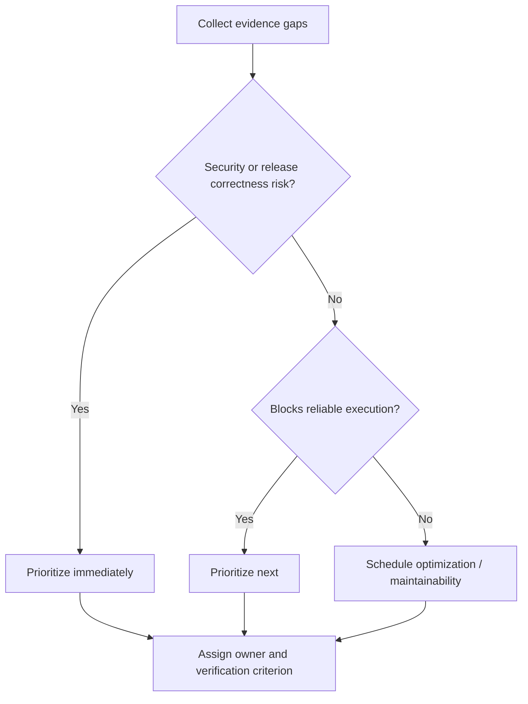

# Knowledge gaps and learning priorities

## Prioritize by impact, not chapter order
The final phase should identify what remains uncertain. A missing command flag may be low risk; uncertainty about privileged runner exposure or mandatory gate enforcement is high risk. Treat **knowledge gap**, **configuration gap** and **operational validation gap** separately. A learner may understand a feature while the enterprise environment still lacks it.

## Risk-weighted gap register
| Gap | Consequence | Priority | Evidence needed |
|---|---|---|---|
| Fortify Rust support unknown | Unsupported security assurance | High | Product/version capability confirmation |
| Gate enforcement unclear | Unsafe release despite red result | High | CI and policy contract review |
| Shared Shell runner trust | Secret/host exposure | High | Scope, account and ACL review |
| Cargo cache strategy unknown | Slower jobs | Medium | Cache logs and size measurements |
| Artifact retention unspecified | Lost audit/release evidence | Medium | Retention policy and storage review |
| Minor YAML reuse style | Maintainability | Low | Template review |

## Learning order
First close conceptual errors that produce unsafe decisions: execution versus acceptance, cache versus artifact, and runner eligibility versus host privileges. Next close configuration gaps that affect correctness: `needs`, protected variables, PowerShell exit handling and scanner input formats. Only then optimize performance and reuse.

## Version-sensitive knowledge
GitLab Runner registration methods, GitLab permission features, SonarQube Rust support, Nexus IQ ingestion methods and Fortify capabilities can change by release or license. Do not promote illustrative documentation into a claim about a specific enterprise installation. Maintain a version-and-evidence table when access becomes available.

## Evidence without infrastructure
The current handbook deliberately avoids executing live pipelines. It can still support strong L1 and L2 assessment through design review, YAML reasoning, threat modeling and sanitized logs. It cannot honestly establish that the production runner, scanner integrations or network routes work. Mark those checks **Unknown — requires authorized runtime validation**.

## Exit criteria
A gap is closed only when the candidate can explain the relevant contract, identify its owner, demonstrate the correct configuration or diagnostic reasoning, and state the verification method. “Looks reasonable” is partial evidence, not closure.

**Outcome:** A prioritized backlog that targets risk and avoids repeating already understood material.
