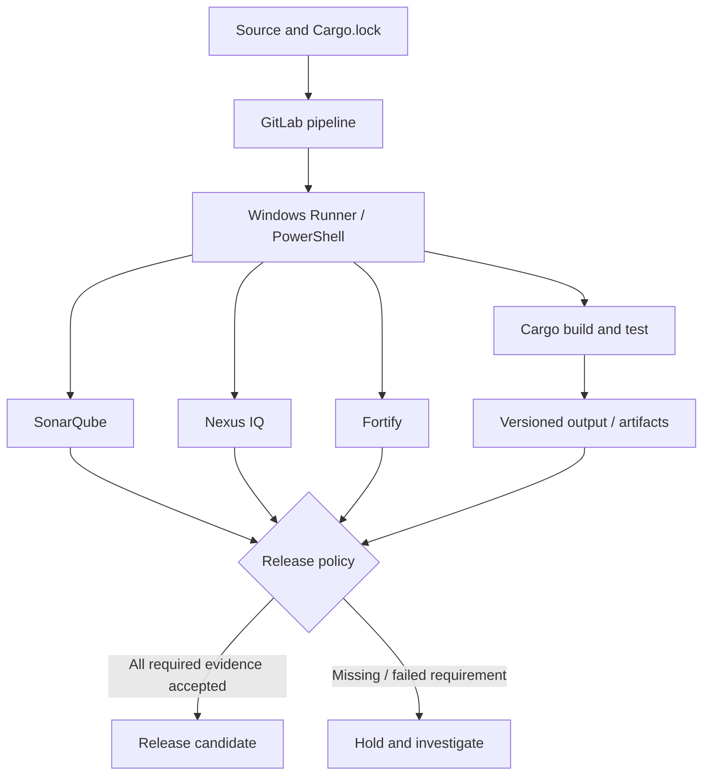

# Final conclusions: enterprise readiness

## What the roadmap establishes
P0–P12 provide the foundations for understanding an enterprise Rust CI/CD system: GitLab pipeline architecture, Rust and Cargo, YAML scheduling, permissions, caching, Windows Runners, migration from GitHub Actions, SonarQube, Nexus IQ, Fortify, integration and troubleshooting. P13 turns those subjects into an evidence-based readiness assessment.

## The reference mental model

## Five principles worth retaining
1. **Correctness before performance.** A build must not depend on a cache hit.
2. **Identity before access.** Runner eligibility, service account privilege and scanner tokens are different controls.
3. **Provenance before acceptance.** Artifacts and analysis must correspond to the intended commit and configuration.
4. **Explicit policy before green status.** Successful scanner execution does not automatically mean the release is approved.
5. **Evidence before workaround.** Diagnose the earliest violated contract; do not bypass TLS or mandatory gates to hide failures.

## Final competency matrix
| Capability | Minimum conceptual proof | Higher-level proof |
|---|---|---|
| Pipeline | Explain triggers, stages and DAG | Review changes and isolate scheduling faults |
| Runner | Explain service/executor | Diagnose service identity and host environment |
| Rust/Cargo | Explain lockfile, target, build | Isolate dependency and toolchain issues |
| Data movement | Explain cache/artifact difference | Design reliable cross-job transfer |
| Security tooling | Explain separate evidence streams | Review enforcement and investigate failures |
| Governance | Explain trust boundaries | Reject unsafe shortcuts and document exceptions |

## Documentation-only limitation
No live GitLab instance, Windows service, Cargo build or scanning infrastructure was accessed as part of this phase. The examples are teaching artifacts and must not be represented as production-tested configurations. Product capabilities—particularly Rust support in commercial scanners—must be checked against installed versions and entitlements.

## Suggested review exercise
Given a pipeline where tests pass, the build artifact is present, Nexus IQ fails a license rule, SonarQube's gate is pending, and Fortify is unavailable, explain why release must wait under a policy requiring all three approvals. Identify the exact missing evidence and the owner of each next action. Then propose a safe path for resolving the blockage without weakening controls.

## Definition of completion
The handbook is structurally complete when P0–P13 are present. **Enterprise readiness** is a separate claim requiring evidence that the target role can reason about architecture, make safe changes and troubleshoot representative incidents. Operational readiness additionally requires authorized testing in the real environment.

**Final conclusion:** A trustworthy pipeline is a chain of explicit contracts. The developer's skill is to understand each contract, preserve it during changes and identify exactly where it failed.
