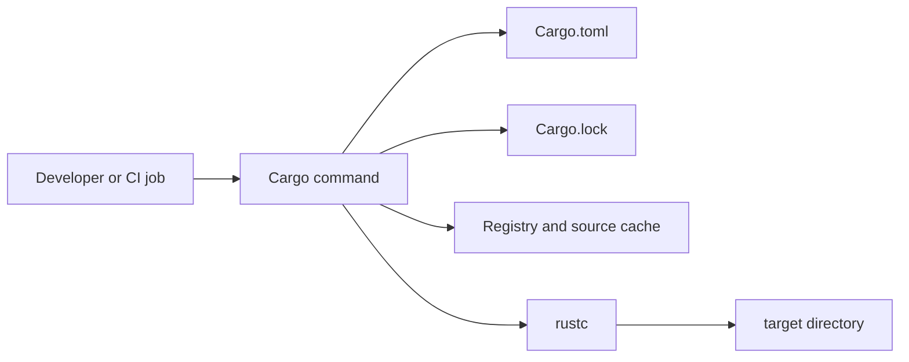
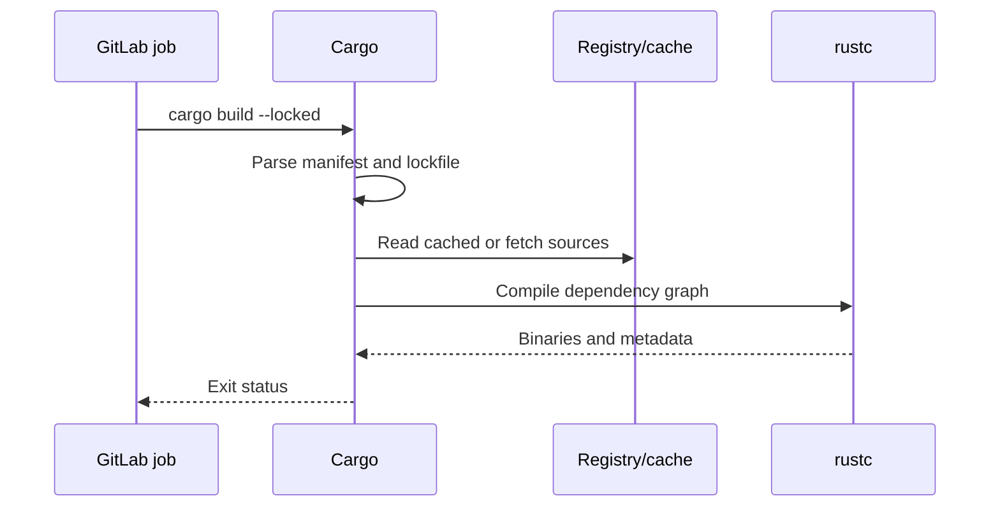

# Cargo: concepts and lifecycle

## Cargo's place in the Rust toolchain

Cargo is the Rust package manager and build orchestrator. `rustc` compiles Rust source; Cargo decides **which** sources and dependencies to compile, with **which** features and profiles, and where outputs belong. `rustup` manages installed Rust toolchains, including compiler versions and targets. This separation matters when a GitLab job reports “cargo not found” versus “rustc cannot compile”: the first is a tool availability or PATH problem; the second may be a compiler, code, dependency, or target problem.

A **package** is described by a `Cargo.toml` manifest. A package can contain a library crate, binary crates, examples, tests, and benchmarks. A **crate** is a compilation unit. A **workspace** groups packages for coordinated dependency resolution and build output. A **registry** indexes downloadable packages; crates.io is the default public registry. A **lockfile** records exact resolved dependency versions. These are separate objects: a workspace is not a single crate, and a registry is not a source-control repository.



## The build lifecycle

When you invoke `cargo build`, Cargo locates the manifest, resolves dependencies and features, consults the lockfile, obtains missing source packages, computes the build graph, and invokes `rustc` as needed. Incremental results can be reused locally when inputs and compilation settings remain compatible. A successful command does not imply that tests ran or that a security scanner approved the dependencies.



### Common commands and what they guarantee

| Command | Intent | Does not guarantee |
|---|---|---|
| `cargo check` | Type-check most code quickly | Runnable binary or test pass |
| `cargo build` | Compile selected targets | Tests or lint clean |
| `cargo test` | Build and run tests | Production deployment readiness |
| `cargo fmt --check` | Check formatting | Semantic correctness |
| `cargo clippy -- -D warnings` | Enforce lint policy | Vulnerability-free dependencies |
| `cargo metadata` | Describe resolved workspace graph | That all external systems are reachable |

## Manifest and command context

```toml
[package]
name = "inventory-cli"
version = "0.1.0"
edition = "2024"

[dependencies]
serde = { version = "1", features = ["derive"] }
```

The manifest expresses package identity and direct dependencies. Cargo interprets the file relative to its directory, so a GitLab job must either run from the correct workspace root or pass `--manifest-path path/to/Cargo.toml`. `cargo build --manifest-path services/api/Cargo.toml` targets that manifest without relying on a prior `cd`.

## What changes in CI

CI machines often start without a populated Cargo cache. A Windows Shell runner may retain local files across jobs, but this is not a contractual guarantee of clean or shared state. GitLab's job workspace, Cargo's home (`CARGO_HOME`), the target directory (`CARGO_TARGET_DIR`), and GitLab cache/artifact locations are distinct. Do not treat a cached `target/` directory as a reproducibility mechanism; the lockfile and pinned toolchain do that work more directly.

In PowerShell, `cargo --version` and `rustc --version` should be visible to the service account actually running the runner. An interactive user's PATH may differ from a Windows service's environment. Avoid embedding credentials in manifest files; registry credentials belong in approved CI secret mechanisms.

## Enterprise decision points

Choose whether CI is allowed to reach public crates.io, uses an internal registry mirror, or operates offline with preloaded sources. Establish which Rust toolchain versions are supported, which lockfile policy applies, and whether build artifacts must be signed or retained. These are separate governance decisions from Cargo's basic command syntax.

### Conclusions

Cargo is the coordinator, not the compiler, runner, or scanner. To diagnose failures, first locate the boundary: GitLab scheduling, Windows process environment, Cargo dependency resolution, `rustc` compilation, or downstream scanning. **Knowledge check:** Can you explain why a pipeline can run `cargo check` successfully but fail `cargo test`? Can you identify where a registry timeout occurs in the sequence diagram?
