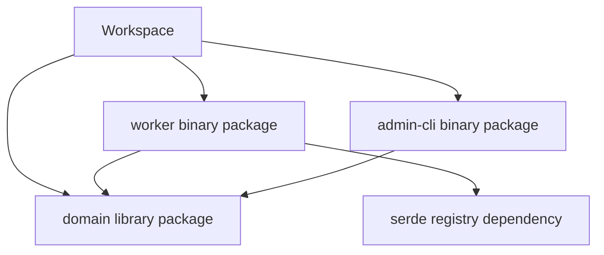
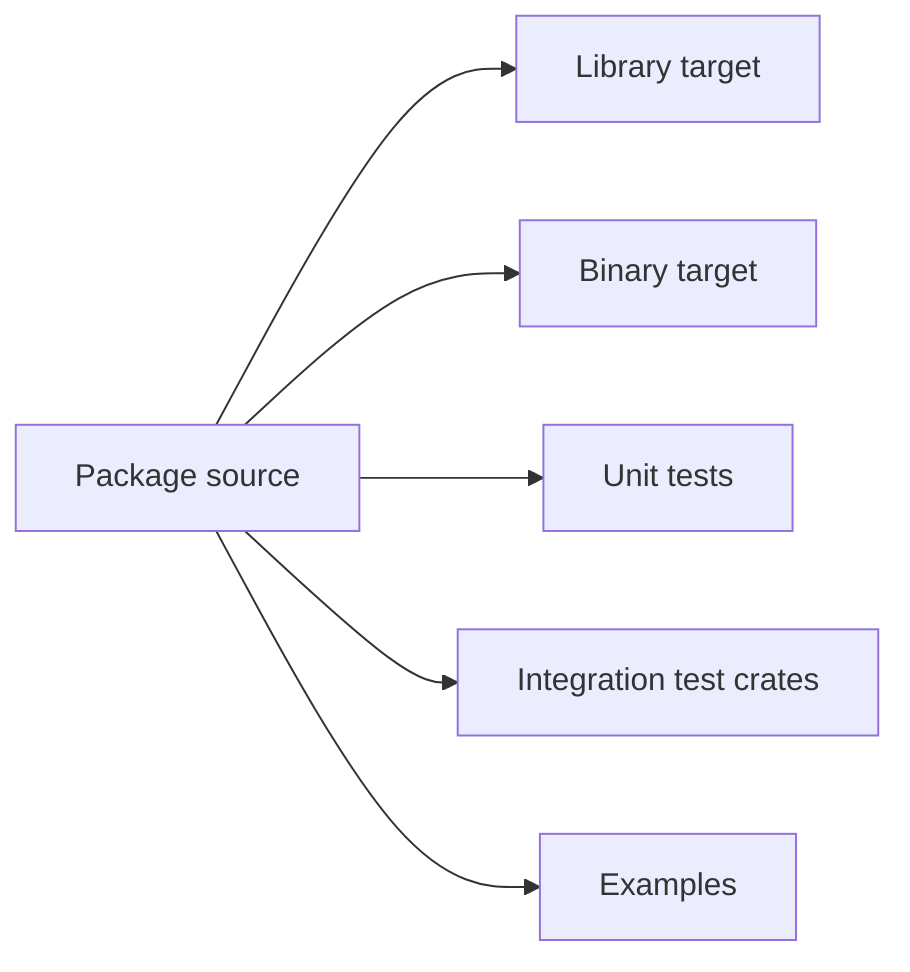

# Packages, crates, targets and workspaces

## The vocabulary that prevents architecture mistakes

A package is a distributable Cargo unit described by one manifest. A crate is the unit compiled by `rustc`. A package can have a library crate and multiple binary targets; a workspace can contain multiple packages. A **target** identifies something Cargo can build: library, binary, example, test or benchmark. This distinction becomes important when an enterprise monorepo contains a CLI, shared domain library and integration adapter under one GitLab pipeline.

```text
platform/
  Cargo.toml             # workspace manifest
  Cargo.lock             # shared dependency resolution
  crates/domain/
    Cargo.toml
    src/lib.rs
  apps/worker/
    Cargo.toml
    src/main.rs
  apps/admin-cli/
    Cargo.toml
    src/main.rs
```

```toml
# platform/Cargo.toml
[workspace]
members = ["crates/domain", "apps/worker", "apps/admin-cli"]
resolver = "3"

[workspace.dependencies]
serde = { version = "1", features = ["derive"] }
```

```toml
# apps/worker/Cargo.toml
[package]
name = "worker"
version = "0.1.0"
edition = "2024"

[dependencies]
domain = { path = "../../crates/domain" }
serde = { workspace = true }
```

The workspace root does not necessarily define a package itself. The `members` list controls membership; shared dependency declarations reduce drift but do not force all members to enable identical features. `resolver = "3"` is appropriate for a Rust 2024-oriented workspace when supported by the toolchain; older repositories may use resolver 2. Follow the repository's existing edition and toolchain policy rather than upgrading reflexively.

## Compilation relationships



A library crate exposes reusable interfaces. A binary crate has an executable entry point. The dependency arrows indicate compile-time references, not deployment dependencies: the worker might need a database at runtime, but that does not make the database a Cargo dependency.

## Selecting work in CI

| Command | Selection behavior |
|---|---|
| `cargo build --workspace` | Build default targets across members |
| `cargo test --workspace` | Run tests across members |
| `cargo test -p domain` | Test a named package |
| `cargo run -p worker` | Run selected binary package |
| `cargo build --bin worker` | Build a binary target where unambiguous |
| `cargo metadata --no-deps --format-version 1` | Inspect workspace/package metadata |

Be careful with working directories: a command run from a member manifest can have different defaults than one run at the workspace root. In CI, make package selection explicit to prevent accidental omissions.

## Tests are not all the same target

Unit tests can live alongside source using `#[cfg(test)]`; integration tests commonly live under a package's `tests/` directory and compile as separate crates. Examples may require additional feature flags or services. A successful `cargo test -p domain` does not establish that the entire workspace builds or that the worker's database integration succeeds.



## Practical architecture choices

A workspace is useful when packages share versioning and build infrastructure, but it can increase lockfile coupling and cache churn. Separate repositories simplify independent release boundaries but increase cross-repository dependency management. For a Java developer, a Cargo workspace resembles a Maven multi-module reactor in organizational purpose; however, Cargo's crate/target model and feature unification differ from Maven modules and scopes.

### CI design implication

A single `cargo test --workspace --locked` job is a reasonable baseline for a small workspace. A larger repository may split package tests, but parallel jobs need explicit artifact and cache decisions. The GitLab `needs` graph governs job scheduling; Cargo's dependency graph governs compilation inside a job. They are different graphs and should not be confused.

### Conclusions

Understand the hierarchy **workspace → packages → targets/crates** before deciding which commands a pipeline should run. Review questions: If a job tests only `worker`, which shared packages are compiled and which packages' tests are skipped? Why might a new package not be included in workspace-wide validation?
