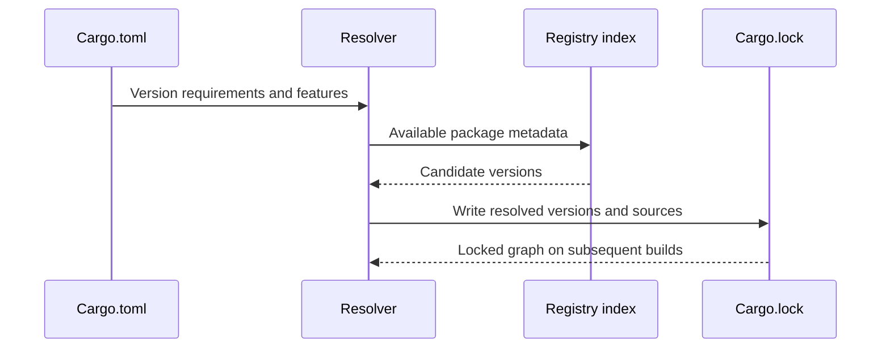

# Dependency declarations and version resolution

## From a manifest constraint to a concrete graph

A dependency entry in `Cargo.toml` is normally a **version requirement**, not an exact resolved version. Cargo selects a compatible dependency graph and records precise package versions and sources in `Cargo.lock`. The lockfile supports repeatable resolution, but it does not freeze compiler behavior, operating system libraries, or external services.

```toml
[dependencies]
serde = { version = "1.0", features = ["derive"] }
anyhow = "1"

[dev-dependencies]
tempfile = "3"

[build-dependencies]
cc = "1"
```

Normal dependencies are used by production code; dev dependencies support tests/examples/benchmarks; build dependencies are compiled for build scripts. These categories do not map one-to-one to Maven scopes. A Rust package can also declare target-specific dependencies and optional dependencies activated by features.

## Resolution and lockfile policy



`cargo build --locked` requires Cargo to use the existing lockfile without changing it; it fails when resolution would require a lockfile update. `cargo build --frozen` adds offline behavior. `cargo update` may deliberately revise lockfile selections within constraints. `cargo update -p some-crate` targets a particular package selection, subject to dependency compatibility.

| Situation | Expected investigation |
|---|---|
| `--locked` fails after manifest edit | Lockfile needs intentional update and review |
| Registry access times out | Proxy, DNS, registry mirror or credentials |
| Two versions of a crate appear | Semver constraints and transitive dependencies |
| Vulnerable transitive dependency | Dependency tree, compatible upgrade, policy exception |
| Works locally but fails in CI | Lockfile, toolchain, target or registry differences |

## Features and dependency edges

Features are compile-time configuration switches that can activate optional dependencies or code paths. Features are additive for a given package resolution context; selecting two dependents can enable more features than either alone. That can change compilation, binary size, and security exposure.

```toml
[features]
default = ["json"]
json = ["dep:serde_json"]

[dependencies]
serde_json = { version = "1", optional = true }
```

A feature is not a secret or runtime environment variable. `cargo build --no-default-features --features json` changes the compiled feature set, whereas a GitLab CI variable influences command construction or process behavior. Review feature combinations when a scanner analyzes only a subset of targets.

## Source types and supply chain

Cargo supports registry, Git and path dependencies. Path dependencies are useful inside a workspace; Git dependencies can pin a branch, tag or revision; registry dependencies normally have checksums recorded in the lockfile. Enterprises may restrict unreviewed Git dependencies or require an internal mirror. The source type affects how reproducibility and vulnerability inventory are assessed.

```bash
cargo tree
cargo tree -d
cargo metadata --format-version 1
cargo update --dry-run
```

`cargo tree -d` helps identify duplicate versions; it does not by itself establish a vulnerability. Cargo's metadata output is useful for tooling, but scanners differ in how they support Rust and lockfiles. Validate the actual product/version before claiming that Nexus IQ or another scanner fully understands every Cargo dependency source.

## Private registries

Private registry configuration can live in Cargo configuration files, while credentials should come from approved credential providers or CI secrets. Do not commit registry tokens into `.cargo/config.toml`. Windows runner service identities may have different user home directories, affecting where Cargo looks for config and credentials.

### Conclusions

The manifest states **allowed dependency choices**; the lockfile states **selected choices**. Dependency policy is a supply-chain concern distinct from compilation. Check: Can you explain why `cargo build` succeeds but `cargo build --locked` fails? Can you identify the security implications of a Git dependency tracking a mutable branch?
