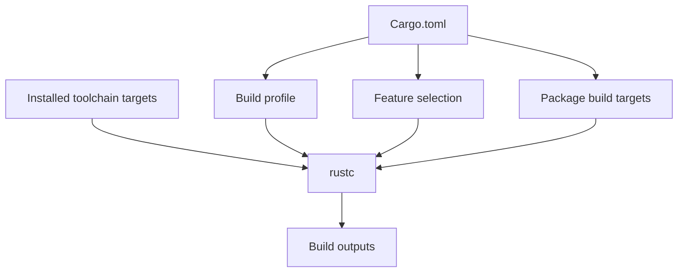

# Build profiles, features and compilation targets

## Three independent dimensions

A **profile** controls compiler settings such as optimization and debug information. A **feature** selects compile-time capabilities in dependencies or your package. A **target** can mean a Cargo build target (binary/library/example) or a platform target triple (such as Windows GNU versus Windows MSVC). Treating these as one switch leads to misleading CI results.



## Profiles

Cargo includes development and release profiles. Release typically prioritizes optimized output; development favors faster edit/build cycles. Customize settings only with a measured reason.

```toml
[profile.release]
opt-level = 3
lto = "thin"
codegen-units = 1

[profile.dev]
debug = true
```

These settings affect compile time, binary size, runtime performance and cache compatibility. `cargo build --release` does not automatically mean “production-ready”: tests, dependency review, code analysis and deployment controls remain separate.

## Feature selection

```toml
[features]
default = ["http"]
http = ["dep:reqwest"]
minimal = []

[dependencies]
reqwest = { version = "0.12", optional = true }
```

A CI matrix may build default features, `--no-default-features`, and selected supported combinations. Avoid indiscriminately testing every theoretical combination: feature combinations grow exponentially and some are intentionally incompatible. Document supported configurations and use `cargo check --all-features` only where that combination is valid.

## Windows platform targets

Windows Rust environments commonly use the MSVC toolchain, for example `x86_64-pc-windows-msvc`. Native dependencies may need Microsoft build tools and compatible linker libraries. Installing Rust alone does not guarantee a C/C++ toolchain is available. Cross-compiling from Linux to Windows introduces separate linker and dependency requirements; a Windows Shell runner is often simpler for native Windows integration tests.

```powershell
rustup show
rustup target list --installed
cargo build --release --target x86_64-pc-windows-msvc
```

`--target` chooses a platform target triple, not a package target. The resulting output location commonly includes `target/<triple>/release/`. Do not hard-code an output path without verifying the actual manifest, target and `CARGO_TARGET_DIR` settings.

## Distinguishing commands

| Command | Main choice | Typical enterprise purpose |
|---|---|---|
| `cargo build --release` | Profile | Produce optimized binary |
| `cargo test --no-default-features` | Features | Validate minimal configuration |
| `cargo build --bin agent` | Cargo target | Build one executable |
| `cargo build --target ...` | Platform target | Build for chosen OS/ABI |
| `cargo check --all-targets` | Cargo targets | Type-check test/example code too |

## CI-specific concerns

A build cache created with different compiler flags or target triples may provide limited reuse. Build artifacts intended for release should be created with explicitly recorded toolchain, profile, feature selection and platform target. GitLab artifacts should retain the deliverable and associated provenance information; GitLab cache is primarily an optimization, not a release store.

```yaml
windows-release:
  tags: [windows, rust]
  script:
    - rustc --version
    - cargo build --release --locked
  artifacts:
    paths:
      - target/release/agent.exe
```

This illustrative job assumes the executable is named `agent.exe` and the runner uses a compatible PowerShell shell. In real projects, confirm the binary target and output directory. A protected release process may require signing and promotion beyond this job.

### Conclusions

Ask three separate questions when a build differs: **Which profile? Which features? Which target?** Then inspect compiler/toolchain versions and native prerequisites. Knowledge check: Why might a release binary differ from the binary produced by `cargo test`? Why could the same manifest compile on Linux but fail on Windows MSVC?
