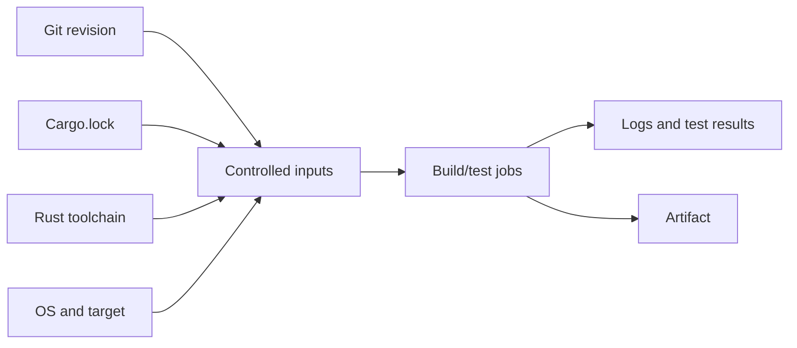

# Testing, lockfiles and reproducible builds

## What “reproducible” really means

A lockfile fixes dependency resolution, but byte-for-byte reproducibility can also depend on compiler version, target triple, environment, build scripts, timestamps and native libraries. Enterprise CI should aim first for **repeatable inputs and observable outputs**, then tighten to reproducible artifacts where the delivery requirements justify it.



## Lockfile workflow

Applications and binary deliverables should normally commit `Cargo.lock`. Library authors may follow different lockfile publication practices, but repository CI still needs a defined policy. `--locked` is a useful CI guard because it refuses unreviewed dependency-resolution changes. Use `cargo update` intentionally, inspect diffs, and run the relevant tests before merging.

```powershell
cargo check --locked
cargo test --workspace --locked
cargo build --release --locked
```

A successful `cargo test --locked` proves that the selected tests ran under the current environment, not that all platform targets, integration services or security requirements were validated.

## Test categories

| Category | Typical location or tool | Primary question |
|---|---|---|
| Unit tests | `#[cfg(test)]` in modules | Does a small unit behave correctly? |
| Integration tests | `tests/` | Do public interfaces work together? |
| Documentation tests | Rustdoc code examples | Do examples compile/run as expected? |
| End-to-end tests | External harness/services | Does the full system meet behavior? |
| Lints | Clippy | Are suspicious patterns present? |
| Formatting | rustfmt | Does source meet style policy? |

Do not equate a linter with a security scanner. Clippy catches code-quality patterns, while SonarQube, Nexus IQ and Fortify have different capabilities and Rust support constraints that must be checked for the deployed versions.

## Static CI reference

```yaml
stages: [verify, build]

rust-verify:
  stage: verify
  tags: [windows, rust]
  script:
    - cargo fmt --all -- --check
    - cargo clippy --workspace --all-targets --locked -- -D warnings
    - cargo test --workspace --locked

rust-release:
  stage: build
  tags: [windows, rust]
  script:
    - cargo build --release --locked
  artifacts:
    paths:
      - target/release/worker.exe
```

This is illustrative, not executed. It assumes a Windows Shell runner with a usable Rust toolchain and an executable named `worker.exe`. The build job compiles independently unless the pipeline deliberately transfers outputs; stage order does not automatically share a filesystem between runners.

## External dependencies and test determinism

A database-backed integration test is sensitive to service readiness, test data, ports and credentials. Separate unit tests from tests requiring external infrastructure so failures are diagnosable. Avoid silently skipping tests when services are absent; record which checks ran and which were intentionally deferred. Windows Shell runners can retain state between jobs, so cleanup and isolated test directories are especially important.

## Evidence and failure analysis

When a test fails, capture command, compiler version, package/target selection, feature flags and relevant environment. A green CI job is meaningful only when it ran the intended commands. Use GitLab job logs and retained test reports where available; configure report formats deliberately rather than assuming Cargo emits GitLab-compatible JUnit XML by default.

### Conclusions

Repeatability is a system property, not a single Cargo flag. The minimum enterprise baseline combines a reviewed lockfile, controlled toolchain, explicit command selection, deterministic test fixtures and retained evidence. Review: Why might two `--locked` builds produce different bytes? Why is a green unit-test job insufficient for a network-dependent worker?
