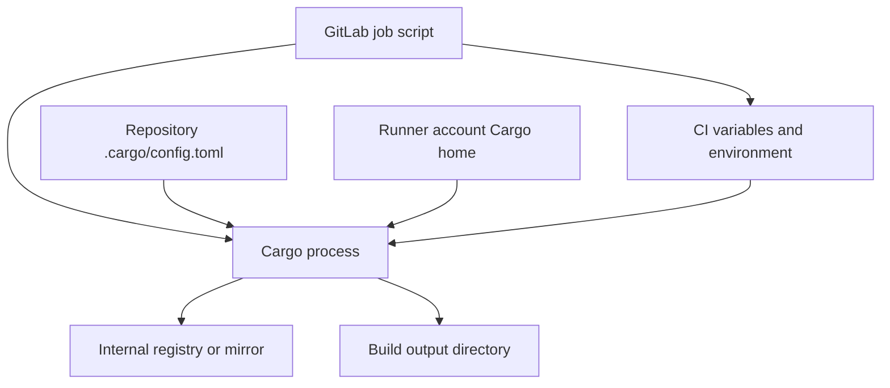

# Cargo configuration in enterprise environments

## Configuration sources and ownership

Cargo configuration is distinct from `Cargo.toml`. The manifest describes a package; Cargo configuration controls tooling behavior such as registries, networking, build targets and output directories. Configuration can be supplied by files such as `.cargo/config.toml`, environment variables and command-line options. Precedence and discovery depend on where Cargo is invoked, so avoid assuming that an interactive user's home configuration is available to a Windows runner service.



## Representative configuration

```toml
# .cargo/config.toml
[build]
target-dir = "target"

[net]
retry = 2

[alias]
ci-check = "check --workspace --locked"
```

This example is intentionally small. A registry mirror may require `[source]` replacement or an alternative registry configuration, but the correct design depends on enterprise policy and registry product. Do not copy arbitrary internet mirror settings into a corporate repository. Document the trust model and approved endpoints.

## Environment variables in PowerShell

```powershell
$env:CARGO_HOME = Join-Path $env:CI_PROJECT_DIR '.cargo-home'
$env:CARGO_TARGET_DIR = Join-Path $env:CI_PROJECT_DIR 'target'
cargo --version
cargo metadata --no-deps --format-version 1
```

`CARGO_HOME` controls Cargo's home, including caches and configuration. `CARGO_TARGET_DIR` controls build outputs. They are not interchangeable, and setting either inside a job does not automatically create a GitLab cache. The GitLab `cache:paths` setting must explicitly select project-relative paths for upload/restoration.

## Windows Runner configuration boundary

| Concern | Primary owner |
|---|---|
| Runner executable, service identity, executor | Windows host and runner `config.toml` |
| Which runner can pick up job | GitLab runner settings and job `tags` |
| Cargo build commands | `.gitlab-ci.yml` `script` |
| Package dependencies | `Cargo.toml` and `Cargo.lock` |
| Registry authentication | Approved CI secret / credential mechanism |
| Cache transfer | GitLab CI cache config and runner cache backend |

A Shell executor executes commands directly on the host under the runner service identity. It offers less isolation than a properly configured container or VM executor. Treat jobs from untrusted branches and forked repositories carefully; do not expose high-value secrets to untrusted code.

## Proxy and TLS concerns

Corporate networks may use HTTPS proxies and private certificate authorities. Diagnose connectivity at the layer that fails: DNS, proxy configuration, TLS trust, registry authorization or dependency metadata. Avoid disabling certificate verification as a workaround. Windows system trust and individual tool certificate behavior can differ, especially for third-party scanners invoked from the same job.

```powershell
Write-Host "Cargo: $(cargo --version)"
Write-Host "Rust: $(rustc --version)"
Write-Host "Workspace: $env:CI_PROJECT_DIR"
# Never print secret tokens or entire sensitive environment dumps.
```

## Practical operational checklist

1. Identify which Windows account runs the GitLab Runner service.
2. Confirm Rust and Cargo are visible to that account.
3. Identify approved registry and outbound network policy.
4. Decide where Cargo home and target output live.
5. Document cache strategy and secret handling separately.
6. Keep toolchain and configuration changes reviewable in version control.

### Conclusions

Cargo settings span repository, process and host boundaries. Enterprise reliability improves when each setting has an explicit owner and no secret is embedded in a committed manifest. Check: Why might Cargo resolve dependencies in a developer terminal but fail as a Windows service? Which configuration would you change to relocate build output without moving registry caches?
