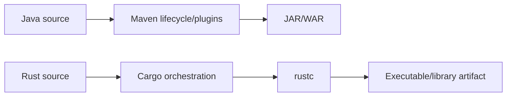

# Cargo versus Maven: a Java developer's mental model

## Similar purpose, different abstractions

Cargo and Maven both coordinate dependencies, compilation and tests, but their models are not interchangeable. Maven organizes lifecycle phases and plugins around projects/modules; Cargo provides integrated commands around Rust packages, crates, targets, features and profiles. A Java developer can use Maven analogies to orient quickly, then deliberately learn where those analogies fail.

| Java/Maven | Rust/Cargo | Important difference |
|---|---|---|
| `pom.xml` | `Cargo.toml` | Cargo manifest also defines Rust targets/features |
| Maven reactor | Cargo workspace | Shared lockfile and feature resolution differ |
| `mvn test` | `cargo test` | Test target discovery and compilation differ |
| `mvn package` | `cargo build --release` (roughly) | Cargo has no identical packaging lifecycle |
| Maven dependency tree | `cargo tree` | Rust feature resolution changes graph behavior |
| Maven repositories | Cargo registries | Protocol, metadata and credential mechanisms differ |
| Maven profiles | Cargo profiles/features | Cargo profiles and features are distinct concepts |
| Maven plugins | Cargo subcommands / external tools | No direct general plugin lifecycle equivalent |

## Dependency resolution comparison

Maven resolves versions through dependency mediation rules; Cargo uses semantic-version requirements and resolves a graph captured in `Cargo.lock`. Cargo can include multiple versions of the same crate where necessary. Rust features can unify across dependency edges, so a workspace-level build may enable code paths not used by a single package in isolation.



## Lifecycle thinking

Maven users often expect a phase such as `verify` to imply earlier phases. Cargo commands are more explicit: `cargo build` does not imply `cargo fmt --check`, `cargo clippy` or `cargo test`. A GitLab pipeline should declare these checks separately and choose ordering using `stages` and `needs`.

```yaml
stages: [quality, test, package]

format:
  stage: quality
  tags: [windows, rust]
  script:
    - cargo fmt --all -- --check

tests:
  stage: test
  tags: [windows, rust]
  script:
    - cargo test --workspace --locked

package:
  stage: package
  tags: [windows, rust]
  script:
    - cargo build --release --locked
```

This is an educational sketch, not an executed pipeline. Unlike a Maven plugin bound to a phase, each GitLab job is a separately scheduled execution unit. Unless artifacts are explicitly transferred, one job's build output is not guaranteed to be available in another job.

## Enterprise repository layout

A Maven multi-module build often has a parent POM and module POMs; a Cargo workspace has a root workspace manifest and member manifests. Both benefit from consistent version policy and shared CI conventions. However, Cargo's `Cargo.lock` and `rust-toolchain.toml` can play particularly visible roles in toolchain/dependency consistency.

```toml
# rust-toolchain.toml (illustrative)
[toolchain]
channel = "stable"
components = ["rustfmt", "clippy"]
```

Using `stable` tracks a moving toolchain; pin an explicit version when repeatability matters. Java teams make a similar decision when choosing between a floating JDK release channel and a specific toolchain version.

## Packaging and deployment

Maven often publishes JARs to Nexus or Artifactory. Rust may produce a native executable or library artifact. A GitLab artifact is temporary CI evidence; an enterprise binary repository or release system may be needed for controlled distribution. Nexus IQ is a policy analysis product, not the same thing as Nexus Repository, and the two should not be conflated.

## Common migration mistakes

Do not assume `cargo build` executes tests. Do not treat Cargo features as Maven profiles. Do not assume a Rust binary built on Linux runs on Windows. Do not confuse a Cargo registry with a GitLab runner cache. And do not expect every Java-oriented SonarQube/Fortify/Nexus IQ integration to support Rust identically; validate product version and scanner capabilities.

### Conclusions

The strongest transferable skills are dependency governance, build graph reasoning, CI failure isolation and artifact promotion. The main conceptual adjustments are crates/targets, feature unification, native platform compilation and Cargo's explicit command model. Review: How would you replace `mvn verify` with a deliberate set of Rust CI checks? Why is a Cargo workspace not simply a Maven reactor with renamed files?
