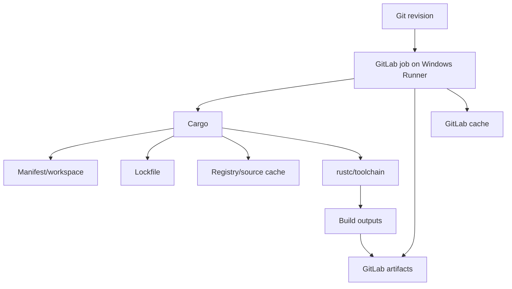
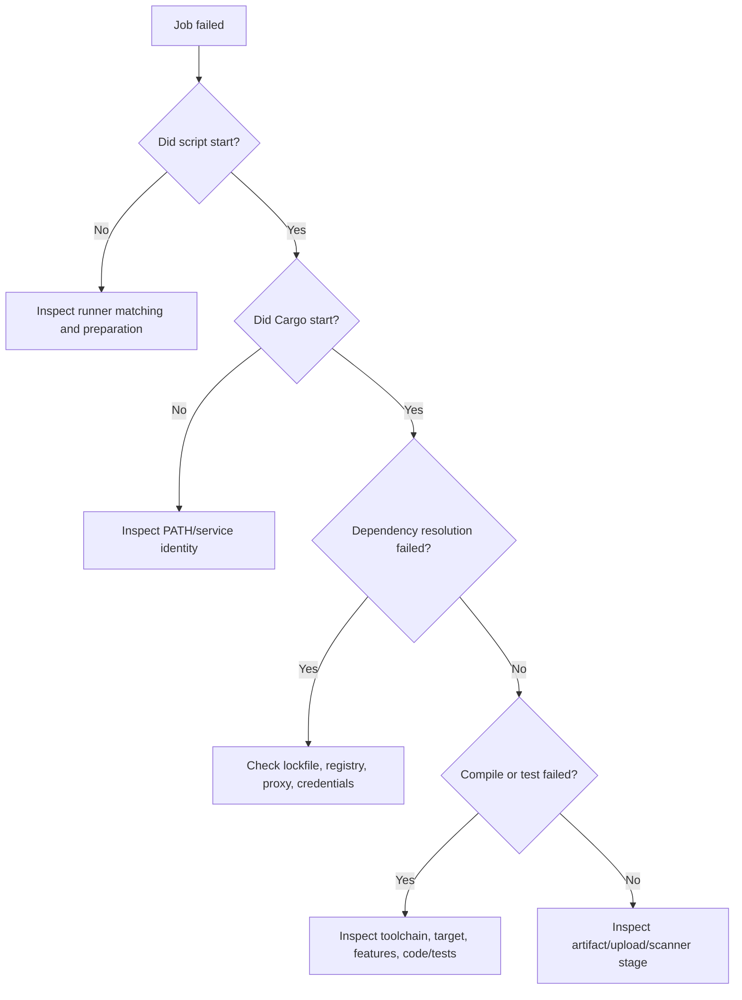

# P2 synthesis: Cargo in an enterprise CI/CD system

## The complete mental model

Cargo's responsibilities begin with package metadata and end with build/test command results. It is not responsible for scheduling GitLab jobs, managing Windows services, approving vulnerabilities or promoting artifacts into production. The most useful troubleshooting skill is identifying which boundary a failure belongs to.

## Key concepts and their ownership

| Concept | Owner or file | Typical risk |
|---|---|---|
| Package identity/dependencies | `Cargo.toml` | Unreviewed dependencies |
| Exact resolution | `Cargo.lock` | Lockfile drift |
| Compiler/toolchain | rustup/toolchain policy | CI/developer mismatch |
| Build profile | Manifest / Cargo invocation | Unexpected performance or output |
| Feature selection | Manifest / Cargo invocation | Untested compile-time paths |
| Cargo source cache | `CARGO_HOME` | Cache miss or credential exposure |
| Build output | `CARGO_TARGET_DIR` | Wrong artifact path |
| Job scheduling | GitLab CI + runner | Pending job / tag mismatch |
| Dependency policy | Security tooling and governance | Unsupported scanner coverage |

## One representative enterprise flow

A developer changes a Rust dependency requirement. The merge request includes a reviewed `Cargo.lock` update. GitLab schedules Windows jobs matching `tags: [windows, rust]`. The runner checks out the revision, restores a compatible Cargo source cache, and invokes `cargo fmt`, `cargo clippy`, `cargo test --locked`, and `cargo build --release --locked`. The jobs publish logs and selected artifacts. Separate scanners may evaluate code quality and dependency risk, but their actual Rust capabilities depend on product and version.

This flow shows why **resolution, compilation, testing, caching and security policy are different concerns**. A successful compile is not evidence that the dependency policy passed. A cache hit is not evidence that the lockfile is correct. A green job is not evidence that an unconfigured check ran.

## Troubleshooting decision tree

## L1: understand

Explain package versus crate versus workspace. Describe the build graph and why `Cargo.lock` matters. Distinguish `CARGO_HOME` from `CARGO_TARGET_DIR`, and identify where GitLab cache and artifacts fit. **Pass criterion:** Correctly assign at least eight of the nine ownership rows above and explain the full diagram without conflating Cargo with GitLab scheduling.

## L2: modify

Given a workspace with two binaries, design a change that tests both but packages only one. Specify Cargo commands, expected output location, Windows runner tags, and the artifact path. Explain why `--locked` belongs in CI and which repository files change when a dependency is updated. **Pass criterion:** Proposed changes are coherent, do not expose secrets and identify the correct configuration owner for every change.

## L3: troubleshoot

**Case A:** `cargo build --locked` fails immediately after a manifest change. Hypothesis: the lockfile no longer represents the manifest. Confirm by examining the error and the lockfile diff; do not remove `--locked` merely to make CI green.

**Case B:** The Windows runner reports `cargo` not recognized, while the developer terminal works. Hypothesis: the runner service identity has a different PATH. Confirm the service account and toolchain visibility without printing secrets.

**Case C:** A cached `target/` directory restores but the release build recompiles most crates. Hypothesis: toolchain/profile/target/feature changes invalidated reusable compilation units. Inspect build flags and cache key design; do not assume the cache is broken solely because compilation occurs.

**Pass criterion:** For each case, distinguish symptom, plausible hypotheses, evidence needed, corrective action and prevention. Avoid presenting a hypothesis as a confirmed root cause before checking evidence.

## Final readiness checklist

- [ ] I can explain Cargo, rustc and rustup separately.
- [ ] I can navigate a workspace and identify package targets.
- [ ] I can explain dependency requirements versus locked resolution.
- [ ] I understand profiles, features and platform targets as different dimensions.
- [ ] I can select formatting, linting, testing and build commands deliberately.
- [ ] I can explain Windows Shell runner environment and Cargo path ownership.
- [ ] I can distinguish GitLab caches, artifacts and release repositories.
- [ ] I can diagnose common registry, lockfile, PATH and compile failures conceptually.
- [ ] I know that live validation and licensed scanner integration are deferred.

### Conclusion

P2 establishes the vocabulary and operational reasoning needed for P3 GitLab YAML and P5 caching. The next phase should translate these Cargo commands into explicitly scheduled jobs, rather than assuming Cargo itself defines a CI pipeline.
