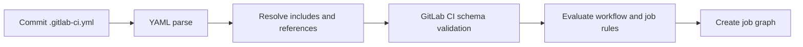

# YAML syntax and fundamentals for GitLab CI

## Why YAML matters

YAML is a data serialization format, not a scripting language. GitLab reads `.gitlab-ci.yml`, validates its structure, expands includes and creates a pipeline graph. A YAML parser first converts indentation and scalar values into a data structure; GitLab then interprets keys such as `script`, `rules` and `needs`. A valid YAML file can therefore still be an invalid GitLab configuration.

### Mappings, sequences and scalar values

```yaml
stages: [lint, test, build] # sequence in flow style
variables:                 # mapping
  RUST_BACKTRACE: "1"      # quoted scalar
lint:                      # mapping: job name
  stage: lint
  tags:
    - windows
    - rust
  script:                  # sequence of shell commands
    - cargo fmt --all -- --check
    - cargo clippy --all-targets -- -D warnings
```

A mapping is a collection of key-value pairs; a sequence is an ordered list. Indentation is structural: use spaces, not tabs. `script` accepts a string or a list of strings, and each command executes in the shell selected by the runner, not in a generic YAML interpreter. Quoting a command as a YAML string does **not** change PowerShell quoting rules.

## Quoting and special characters

YAML treats a colon followed by a space as a mapping separator. A command such as `Write-Host "Build: ready"` may need to be quoted at the YAML level, for example using a block scalar. YAML's `true`, `false`, `null`, numbers and strings may be interpreted differently depending on parser and schema; quote variable values when you intend text.

```yaml
build:
  script:
    - 'Write-Host "Build: ready"'
    - |
      $ErrorActionPreference = 'Stop'
      Write-Host "Commit: $env:CI_COMMIT_SHORT_SHA"
      cargo build --locked
      if ($LASTEXITCODE -ne 0) { exit $LASTEXITCODE }
```

The `|` literal block preserves newlines; `>` folds many newlines into spaces. For multi-line shell programs, prefer `|` to avoid unexpectedly joining commands. Remember that the runner's shell and GitLab's script generation determine how failures propagate; explicitly check native command exit codes in PowerShell examples where necessary.

### Comments, anchors and aliases

```yaml
.rust-base: &rust-base
  tags: [windows, rust]
  before_script:
    - rustc --version

check:
  <<: *rust-base
  script: ["cargo check --locked"]
```

YAML anchors work within a single parsed YAML document; they are not a substitute for GitLab `extends` or cross-file reuse. GitLab supports additional reuse constructs, but the semantics differ. Do not assume that two arrays are automatically concatenated when configurations are merged.

## Parse versus pipeline evaluation



A syntax failure occurs before runner selection. A job that never appears may have been excluded by `rules`; a job stuck pending has already passed creation and needs runner investigation. Distinguishing these stages prevents debugging the wrong system.

## Common mistakes

| Symptom | Likely layer | Check |
|---|---|---|
| `mapping values are not allowed` | YAML parser | Colon, indentation, quoting |
| `unknown keys` | GitLab CI schema | Keyword location, spelling, version |
| Pipeline not created | Workflow evaluation | `workflow:rules`, trigger source |
| Job not present | Job evaluation | `rules`, `only`/`except` legacy configuration |
| Script runs wrong syntax | Shell | Runner executor and configured shell |

## Enterprise application

Review shared CI templates as code: require merge requests, ownership, pinned include references where feasible, and validation against the target GitLab version. Never paste secrets into YAML. Keep examples for Windows Shell runners separate from Linux Docker jobs because quoting, path separators and executable availability differ.

## Conclusions and knowledge check

YAML expresses the configuration tree; GitLab determines the pipeline semantics; the runner executes shell commands. Explain why a valid YAML parser result does not guarantee a pipeline. Predict how the `script` block above differs on Windows PowerShell versus Bash. Locate a malformed colon and explain which layer rejects it.
