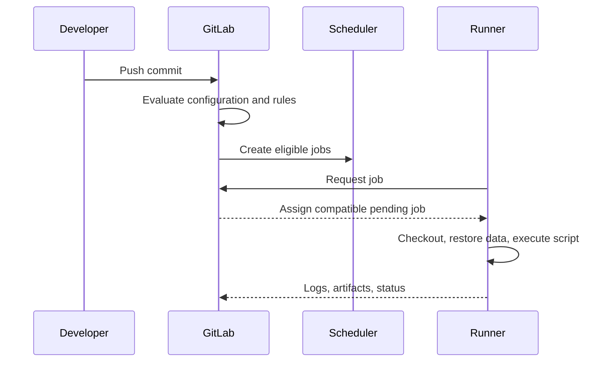

# GitLab CI concepts and keywords

## Configuration as a declarative execution contract

A `.gitlab-ci.yml` describes **which jobs may exist**, their ordering, their execution environment requirements and the commands to run. It does not itself run commands. GitLab creates pipeline records and job records, then runners request eligible jobs. A job's `script` is interpreted by the runner's shell.

### Main keyword families

| Family | Keywords | Core question |
|---|---|---|
| Pipeline admission | `workflow`, `rules` | Should this pipeline exist? |
| Job admission | `rules`, `when`, `allow_failure` | Should this job exist and how may it fail? |
| Graph | `stages`, `stage`, `needs` | What must finish before what? |
| Execution | `script`, `before_script`, `after_script`, `tags` | What executes and on which runner? |
| Data | `variables`, `cache`, `artifacts` | What values and files are available? |
| Reuse | `include`, `extends`, `default`, `!reference` | How is configuration composed? |
| Deployment | `environment`, `resource_group` | Which environment is targeted and what must serialize? |

## Global and job-level scope

```yaml
stages: [verify, package]
default:
  tags: [windows, rust]
  interruptible: true
variables:
  CARGO_TERM_COLOR: always
verify:
  stage: verify
  script:
    - cargo test --locked
package:
  stage: package
  script:
    - cargo build --release --locked
```

`default` supplies supported job keywords when a job does not define them. A job-level value usually overrides the corresponding default rather than merging arbitrarily. Top-level variables can be overridden by job-level variables, but GitLab has a broader variable precedence model that also includes project, group, pipeline and policy variables. Avoid describing one source as universally highest precedence.

### Hidden jobs and reserved keywords

A name beginning with a dot (for example `.rust-common`) is commonly used as a hidden template, not a runnable job. A visible job normally needs `script` or `trigger` (with some job types having specialized forms). Job names are keys, so duplicates can silently create confusing results depending on merge behavior; use distinct names. Do not use reserved global keywords as arbitrary job names.

## A job's life in the system



This explains why changing `tags` affects scheduling but does not install Cargo; changing `script` affects the shell command but does not grant access to a protected secret; and changing `needs` affects dependency scheduling but does not automatically fix missing artifacts.

## Keyword interactions

`workflow:rules` can reject an entire pipeline even if a job's `rules` would otherwise include it. `needs` can let jobs start before all earlier-stage jobs finish, but a `needs` reference to a conditionally absent job can require an optional dependency. `allow_failure` affects the overall pipeline outcome, not whether the command failed. `when: manual` controls user-triggered execution; it is not an access-control mechanism by itself.

## Enterprise review checklist

When reviewing a new CI file, identify pipeline sources, job creation conditions, runner tags, required tools, secrets, cache/artifact flows and external service calls. Annotate ownership boundaries: GitLab controls graph and permissions; runner administrators control machine capabilities; scanner administrators control server policies. The configuration is a contract across these teams.

## Conclusions

A GitLab keyword has meaning only within its configuration scope and version. First determine whether an issue occurs during parsing, graph construction, scheduling or execution. This phase provides the vocabulary for later chapters on rules, DAGs and reusable templates.
