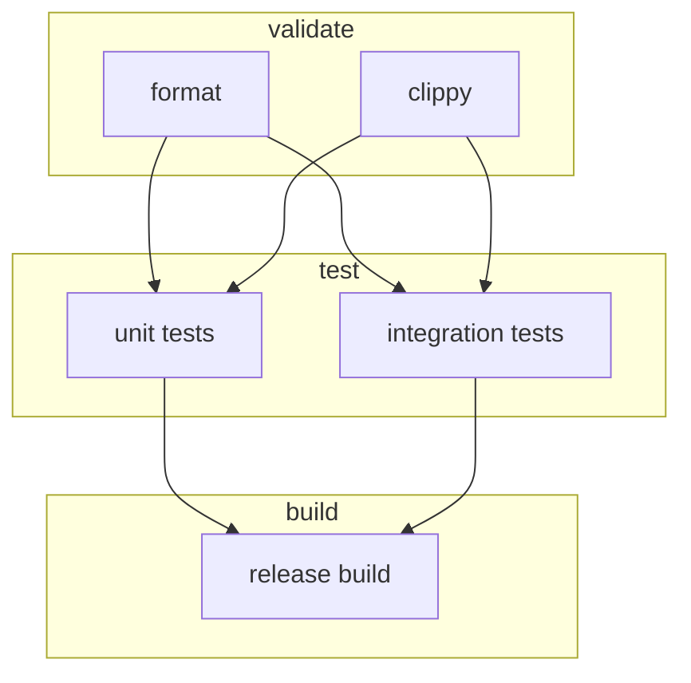

# Pipelines, stages and jobs

## Three different levels of orchestration

A **pipeline** is an execution instance associated with a source such as a push, merge request, schedule, web trigger or parent pipeline. A **stage** groups jobs for default ordering. A **job** is a scheduled execution unit with its own status, logs, variables and file workspace. One pipeline can contain several jobs, and those jobs need not run on the same machine.

```yaml
stages: [validate, test, build]
format:
  stage: validate
  tags: [windows, rust]
  script: ["cargo fmt --all -- --check"]
unit-tests:
  stage: test
  tags: [windows, rust]
  script: ["cargo test --locked"]
release-build:
  stage: build
  tags: [windows, rust]
  script: ["cargo build --release --locked"]
```

By default, jobs in the same stage can run concurrently; jobs in later stages wait for earlier-stage completion subject to GitLab's job and failure semantics. Concurrency depends on runner availability and limits. `stages` are not physical servers and do not imply shared working directories.

## Execution ordering



This is a conceptual stage-barrier view; a real `needs` graph can express a different order. Do not assume arrows represent file transfer. Job dependencies and data dependencies are separate concerns.

### Pipeline sources

| Source | Typical use | Caution |
|---|---|---|
| Push | Branch build | Duplicate pipelines alongside merge-request rules |
| Merge request event | Review validation | Understand source/target branch context |
| Schedule | Nightly security or dependency scan | Credentials and runner availability |
| Web/API trigger | Controlled operational run | Authentication and auditability |
| Parent/child | Modular large CI configuration | Variable and artifact propagation |

A push to a branch with an open merge request can produce overlapping pipelines unless workflow rules deliberately constrain them. A merge-request pipeline is not identical to a merged-results pipeline; verify which type your GitLab installation supports and uses.

## Jobs are isolated execution units

A Windows Shell executor may reuse the same machine and certain on-disk resources, but job workspaces are not a supported cross-job communication channel. Use artifacts for deterministic outputs and cache for opportunistic acceleration. Treat shared runner machines as security-sensitive because jobs can affect machine state; isolation differs significantly from ephemeral container execution.

## Failure and cancellation behavior

A failing job usually prevents ordinary downstream stage jobs from running, while jobs configured with `when: always` or appropriate conditions may still run. `allow_failure` can make a failed job non-blocking. `interruptible` can help cancel superseded jobs when combined with project settings. Manual jobs can be blocking or optional depending on their configuration and context. Never infer success solely from a green pipeline if security checks are allowed to fail.

## Design choices

A stage-oriented pipeline is easy to read and suits small projects. A `needs`-based directed acyclic graph can reduce waiting by starting jobs as soon as their true prerequisites finish. Excessively complex DAGs are harder to debug, so optimize only after documenting dependencies. Use job names that express outputs or checks, not the name of a team member.

## Validation questions

Can two `test` jobs run simultaneously? What changes if only one compatible runner has concurrency one? Can a `build` job access a file created by `test` without artifacts? Explain the difference between a job being skipped by rules and a job being pending because no runner matches its tags.
