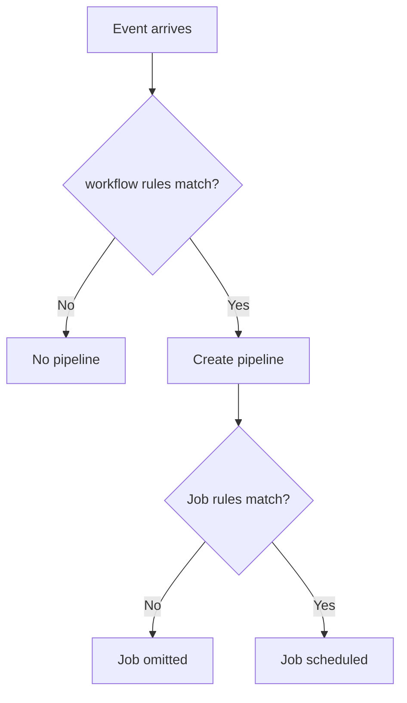

# Rules, workflow and pipeline triggers

## Two decision points

`workflow:rules` determines whether GitLab creates a pipeline for an event. A job's `rules` determines whether that job is included and with which attributes. These are separate evaluations. Rules are checked in order, and the first matching rule controls the result; a terminal `when: never` can explicitly exclude an event.

```yaml
workflow:
  rules:
    - if: '$CI_PIPELINE_SOURCE == "merge_request_event"'
    - if: '$CI_COMMIT_BRANCH == $CI_DEFAULT_BRANCH'
    - when: never

stages: [check, package]
check:
  stage: check
  script: ["cargo test --locked"]
package:
  stage: package
  rules:
    - if: '$CI_COMMIT_BRANCH == $CI_DEFAULT_BRANCH'
  script: ["cargo build --release --locked"]
```

The pipeline is admitted for merge-request events or default-branch pushes; `package` is additionally constrained. `CI_COMMIT_BRANCH` is not present in every pipeline type, notably merge-request pipelines, so design conditions around the source and available variables.

## Rules and conditions

| Condition | Use | Caveat |
|---|---|---|
| `if` | Evaluate CI variables | Expression syntax is GitLab-specific |
| `changes` | Run when paths change | Diff baseline depends on pipeline source |
| `exists` | Check repository paths | Existence is not proof of build readiness |
| `when: manual` | Require deliberate action | Permissions still require separate controls |
| `when: never` | Exclude a match | Rule order matters |

Rules may combine conditions, and the resulting behavior depends on all specified conditions. For schedules, API-triggered and new-branch pipelines, `rules:changes` can surprise developers; consider `compare_to` where appropriate and supported by the GitLab version.

## Avoid duplicate pipelines



A common mistake is combining broad push rules and merge-request rules so both pipelines run for the same change. Start with a source matrix and explicitly decide which pipeline types the project needs. Do not solve duplication by indiscriminately disabling merge-request pipelines: that can remove valuable review checks.

## Manual and scheduled execution

`when: manual` creates a job that a user may trigger in GitLab, subject to role and protected environment constraints. `when: delayed` schedules execution after a delay. Schedules are managed in the GitLab UI/API and have an owner and variable context; they are not created merely by writing a cron expression into `.gitlab-ci.yml`.

## Practical design exercise

Requirement: run format and tests on merge requests; run a release build only on default-branch pushes; do not run branch-push pipelines for every feature branch. Start by writing the event matrix, then author `workflow` and job rules. Check the difference between a default-branch push pipeline and a merge-request pipeline that targets the default branch. The source branch of an MR is not automatically the default branch.

## Debugging decisions

When a job is absent, inspect merged CI configuration, rule order, source variables and pipeline type. When the whole pipeline is absent, inspect `workflow:rules` first. When a job is pending, rules have already admitted it; investigate runner availability instead. GitLab's CI Lint and pipeline simulation capabilities can help, but their exact behavior and UI location vary by version.

## Conclusion

Rules express admission policy, not shell control flow. Make the event matrix explicit, prefer positive conditions and a deliberate fallback, and document why each pipeline type is allowed. This makes enterprise review and future migration from GitHub Actions more reliable.
