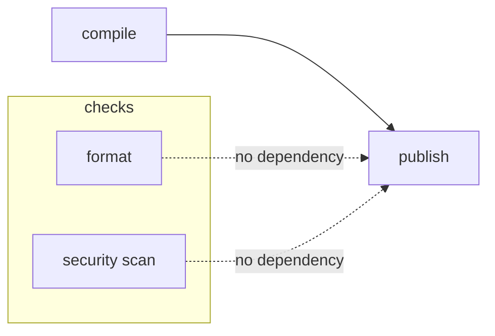

# Needs, dependencies and job graphs

## Ordering is not data transfer

Stages establish a broad ordering barrier. `needs` creates explicit job-to-job scheduling edges so a job can begin when its required predecessors finish, even if other earlier-stage jobs are still running. `dependencies` controls which previous-stage artifacts a job downloads in stage-oriented pipelines; it does not schedule the job. These mechanisms are easy to confuse because they all mention other jobs.

```yaml
stages: [check, build, publish]
format:
  stage: check
  script: ["cargo fmt --all -- --check"]
compile:
  stage: build
  script: ["cargo build --release --locked"]
  artifacts:
    paths: ["target/release/myapp.exe"]
    expire_in: 7 days
publish:
  stage: publish
  needs:
    - job: compile
      artifacts: true
  script:
    - 'Get-Item "target/release/myapp.exe"'
```

This example assumes a binary named `myapp.exe` and a Windows runner; the actual Cargo package target name must match. `publish` needs the `compile` artifact and can start as soon as that job finishes, rather than waiting for every unrelated earlier-stage job. If a needed job is excluded by rules, pipeline creation can fail unless the dependency is appropriately optional.

## Compare scheduling graphs



This graph is illustrative: a real release pipeline may intentionally require security scan completion before publishing. The important question is whether the edge expresses a true safety or data dependency, not whether it makes the pipeline faster.

### `needs` and artifact semantics

With `needs`, artifact download is typically controlled through the entries' `artifacts` settings. Avoid combining `needs` and `dependencies` in the same job; use one clear strategy. `needs: []` means a job can start immediately, subject to scheduler and runner capacity. `needs:optional` supports cases where a referenced job may not be created by rules. Cross-project and child-pipeline artifact mechanisms have their own constraints and should not be treated as equivalent to local job artifacts.

## Data ownership

| Mechanism | Guarantees ordering? | Transfers files? | Typical purpose |
|---|---|---|---|
| Stage order | Yes, broad barrier | Not itself | Simple sequencing |
| `needs` | Yes, explicit edges | Can request artifacts | Faster DAG execution |
| `dependencies` | No | Selects prior artifacts | Narrow artifact download |
| Cache | No | Best-effort reuse | Build acceleration |
| Artifacts | No by themselves | Yes, persisted outputs | Build/test reports |

## Enterprise implications

Do not publish a release before mandatory quality/security gates finish simply to optimize duration. For each job, document **control dependencies** (what must succeed) and **data dependencies** (which files must be available). A security scan that evaluates source independently may run in parallel with compile; a scanner requiring built binaries cannot. A downstream deployment may need approval and protected environment permissions in addition to its `needs` graph.

## Failure cases

A missing artifact can be caused by wrong `paths`, expired retention, a job not producing the file, or a `needs` entry disabling artifact download. A pipeline-creation error about a missing needed job is a graph-definition problem, not a runner problem. A job that starts too early may reflect an omitted safety edge, even if its files are available.

## Conclusion and review

Draw the job graph before adding `needs`. Label each edge as scheduling, data or policy. Explain why `dependencies` cannot make a job start sooner, why cache is not a substitute for artifacts, and why an optional job needs careful handling in the DAG.
