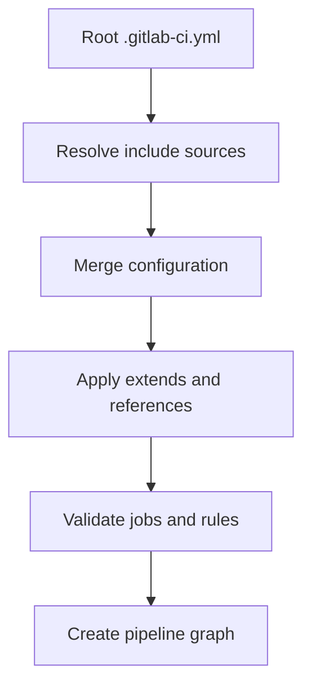

# Includes, extends and CI configuration reuse

## Why reuse exists

Enterprise organizations standardize build, test, security and deployment rules across many repositories. GitLab can compose CI configuration from local files, other projects, remote URLs and supported components/templates. Reuse reduces drift, but it also creates a dependency chain: a template change may alter dozens of pipelines. The first task is to understand **where the final merged configuration comes from**.

### Include sources

```yaml
include:
  - local: '/.gitlab/ci/rust-checks.yml'
  - project: 'platform/ci-templates'
    ref: 'v2.3.0'
    file: '/windows-rust.yml'
```

The second entry is illustrative; the project, ref and file must exist and be readable in the target GitLab environment. Pin shared templates to reviewed tags or immutable references where possible. Do not embed credentials in a remote include URL. Includes are resolved by GitLab during pipeline configuration processing, not by the Windows Runner at job runtime.

## Hidden jobs and `extends`

```yaml
.rust-windows:
  tags: [windows, rust]
  before_script:
    - rustc --version
    - cargo --version

check:
  extends: .rust-windows
  script:
    - cargo check --locked

test:
  extends: .rust-windows
  script:
    - cargo test --locked
```

`extends` performs a GitLab-defined reverse deep merge for supported map keys. Arrays generally replace rather than append automatically. If a child sets its own `before_script`, do not assume it inherits the parent's commands. Deep inheritance can be hard to reason about; prefer small templates with explicit ownership.

## YAML anchors versus GitLab reuse

| Mechanism | Scope | Best use | Main risk |
|---|---|---|---|
| YAML anchors | Same YAML document | Local fragment reuse | Cannot reference anchors across included files |
| `extends` | Merged CI config | Job inheritance | Array replacement and inheritance complexity |
| `include` | Multiple config sources | Organization templates | Version drift and trust boundary |
| `!reference` | Supported GitLab config references | Reuse specific sections | Context and version-specific restrictions |
| CI/CD components | Catalogued reusable units | Parameterized standardized workflows | Component contract/version governance |

## Configuration resolution



This is a conceptual model, not a guarantee of the exact parser's internal operation order. The practical goal is to inspect the merged configuration and understand where a keyword originated.

## Governance and security

Treat external CI templates as privileged code: they can run shell commands and access variables available to the job. Review template ownership, update policy, branch protection and the effect of template changes on protected runners. A group-level template should not silently require tools absent from Windows runners. Maintain compatibility notes for GitLab version, runner shell and supported operating systems.

## Example review scenario

A project extends `.rust-windows` but a job unexpectedly executes Bash syntax. Check whether the template's tags were overridden, whether a compatible runner uses a different shell, and whether the included version changed. The `tags` value selects runner eligibility; it does not force PowerShell by itself. Runner shell configuration remains a runner-side responsibility.

## Conclusion

Reuse should make behavior easier to audit, not merely shorter. For each inherited job, be able to answer: which file defines it, which revision was loaded, what keys were overridden, and which team owns the template? Keep cross-references explicit and validate the merged CI configuration before rollout.
