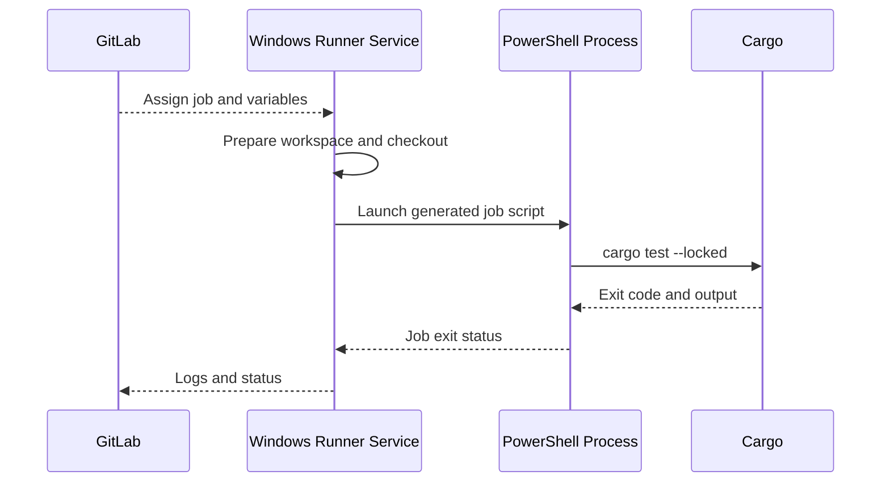

# Scripts, environments and execution

## A GitLab job is a shell execution contract

`script` is a sequence of commands run by the selected runner executor and shell. YAML syntax determines the command text; the shell determines expansion, quoting, pipelines, working directories and error behavior. GitLab prepares the job, checks out the repository according to its settings, restores relevant data and then runs configured commands. `before_script` runs before the main script; `after_script` runs in a separate shell context and should not be relied upon for preserving in-memory state.

### Windows PowerShell example

```yaml
windows-test:
  tags: [windows, rust]
  variables:
    CARGO_TERM_COLOR: always
  before_script:
    - 'Write-Host "Rust: $(rustc --version)"'
  script:
    - |
      $ErrorActionPreference = 'Stop'
      Write-Host "Working directory: $PWD"
      Write-Host "Project directory: $env:CI_PROJECT_DIR"
      cargo test --locked
      if ($LASTEXITCODE -ne 0) { exit $LASTEXITCODE }
  after_script:
    - 'Write-Host "Job finished: $env:CI_JOB_STATUS"'
```

The runner must have Rust/Cargo installed and available to its service account. `$env:NAME` accesses environment variables in PowerShell; Bash uses `$NAME` or `${NAME}`. `$PWD` is a PowerShell location object, while `$env:CI_PROJECT_DIR` is the GitLab-provided checkout path. On Windows, avoid hardcoded `C:\...` paths when project-relative paths are sufficient.

### Bash comparison

```yaml
linux-test:
  tags: [linux, rust]
  script:
    - 'echo "Project: $CI_PROJECT_DIR"'
    - cargo test --locked
```

A job's tags do not install Bash or PowerShell; they only influence matching. The runner administrator chooses executor and shell. The same YAML command can behave differently when interpreted by different shells.

## Native exit codes and error propagation

PowerShell has distinct handling for PowerShell errors and native executable exit codes. `$ErrorActionPreference = 'Stop'` helps with PowerShell errors, but checking `$LASTEXITCODE` is prudent after commands such as `cargo`. For a multi-command script, fail close to the actual failing command so later output does not hide it. GitLab Runner shell generation has evolved; verify error handling against the installed runner version.

## Execution environment boundaries



Job variables are injected into the process environment subject to GitLab's availability and protection rules. Secrets can leak if echoed, embedded in command arguments visible to other processes or written to artifacts. A masked variable is not a complete secret-management boundary.

## `environment` is deployment metadata

```yaml
deploy-staging:
  stage: deploy
  environment:
    name: staging
    url: https://staging.example.invalid
  script:
    - 'Write-Host "Illustrative deployment only"'
```

The `environment` keyword associates a job with an environment record; it does not provision infrastructure or perform deployment by itself. The URL is intentionally non-routable. Protected environments and approvals require corresponding GitLab settings and suitable permissions.

## Practical diagnostics

If `cargo` is not recognized, check the runner service account's PATH, not only your interactive PowerShell session. If a path works locally but not in CI, inspect `$env:CI_PROJECT_DIR`, workspace permissions and whether the file came from checkout or artifacts. If a variable is blank, verify its scope and protection before editing the script. If an external scanner fails with TLS errors, distinguish runner truststore/network issues from scanner authentication failures.

## Conclusions

`script` is shell code transported through GitLab configuration. The runtime contract includes executor, shell, identity, filesystem, environment variables, tools and network access. Read a script line by line with these boundaries in mind; do not mistake YAML quoting for shell quoting or job metadata for infrastructure setup.
