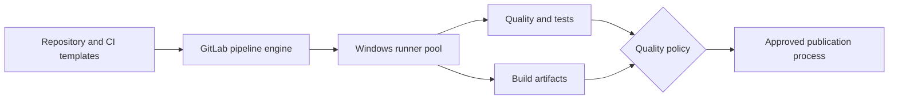

# Validation and enterprise CI patterns

## Validation is layered

A pipeline can pass YAML parsing and still be operationally wrong. Review configuration in layers: syntax, GitLab schema, rule evaluation, job graph, runner compatibility, credentials, data flow and security controls. Static review is possible without access to a live GitLab instance, but it cannot prove that a specific runner or scanner will execute successfully.

| Validation layer | Question | Example evidence |
|---|---|---|
| YAML | Does it parse? | Indentation and scalar checks |
| GitLab schema | Are keywords legal in this context? | CI Lint on matching GitLab version |
| Pipeline policy | Which events create jobs? | Source/rules decision matrix |
| DAG | Are dependencies valid? | Job graph and optional needs |
| Runner | Is there a compatible executor? | Tags, shell, installed tools |
| Data | Are outputs transferred correctly? | Artifact paths and needs entries |
| Security | Can secrets or untrusted code cross boundaries? | Protected refs, variable scopes |

## An enterprise pipeline pattern

```yaml
workflow:
  rules:
    - if: '$CI_PIPELINE_SOURCE == "merge_request_event"'
    - if: '$CI_COMMIT_BRANCH == $CI_DEFAULT_BRANCH'
    - when: never

stages: [quality, build]

default:
  tags: [windows, rust]

format:
  stage: quality
  script: ["cargo fmt --all -- --check"]

test:
  stage: quality
  script: ["cargo test --locked"]

build:
  stage: build
  rules:
    - if: '$CI_COMMIT_BRANCH == $CI_DEFAULT_BRANCH'
  script: ["cargo build --release --locked"]
  artifacts:
    paths: ["target/release/myapp.exe"]
    expire_in: 7 days
```

This is an illustrative configuration, not a tested pipeline. The binary path depends on package naming and build target. A production design would add toolchain version management, dependency policy, security scans, artifact signing/provenance where appropriate and release controls. Do not place scanner tokens in YAML.

## Architecture review



The diagram illustrates responsibilities, not a mandatory single-runner sequence. Scanner integrations may execute on other runner pools or call external servers. Publication should be gated by required results and permissions, not merely by a job name called `quality`.

## Change-review checklist

Before approving a CI change, ask: What pipeline sources are affected? Could new rules create duplicate pipelines? Does a new job use privileged variables on untrusted merge requests? Are the required runner tags available? Are Windows path and shell assumptions explicit? Does a `needs` change bypass a required gate? Are cache and artifacts used for their intended purposes? Does an include pull mutable external configuration?

## Static review scenario

A contributor adds a `security-scan` job with `allow_failure: true` and then says the pipeline is protected by security scanning. The scan may run and report issues, but its failure might not block the pipeline. Review the policy intent and gate semantics. Similarly, adding a protected variable does not make it available to every merge-request pipeline; availability depends on GitLab's protected-ref and MR settings.

## Risk-based validation

Small edits to comments need less scrutiny than changes to shared templates, runner tags, secret handling or release gating. Treat CI as production code: use code review, ownership, versioned templates and rollback plans. Keep a known-good configuration revision. Distinguish “documentation example reviewed” from “tested on this GitLab version” and “verified on a specific Windows runner.”

## Conclusions

Validation is not a single linter pass. Build a chain of evidence from syntax to security boundaries and operational execution. In this learning project, produce reasoned static reviews now and defer actual pipeline execution until explicitly authorized.
