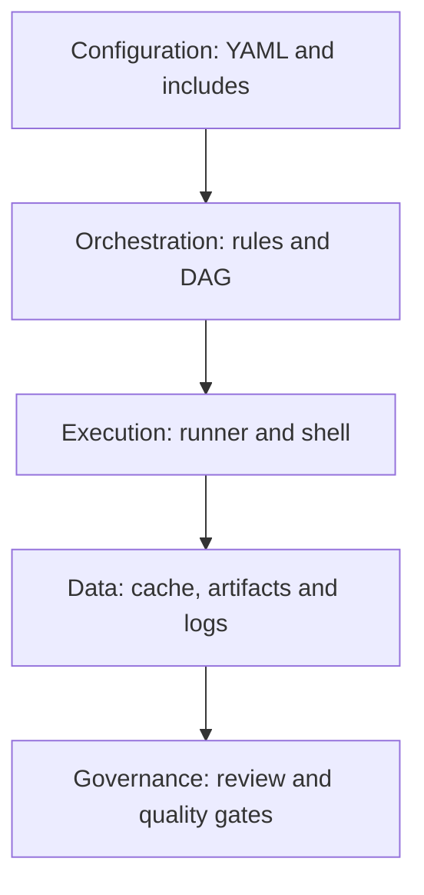

# P3 synthesis: understanding and reviewing GitLab CI YAML

## The central mental model

GitLab CI has three distinct planes: **configuration** (`.gitlab-ci.yml` and includes), **orchestration** (pipeline creation, rules, job graph and scheduling) and **execution** (runner, executor and shell). Many CI mistakes come from treating them as one thing. A job can be valid YAML but omitted by rules; it can be scheduled but pending because no runner matches; it can run but fail because Cargo is absent from the Windows service account PATH.



## Key distinctions

| Often confused | Correct distinction |
|---|---|
| Pipeline vs job | Pipeline is an execution instance; job is an executable unit |
| Stage vs runner | Stage orders work; runner executes work |
| `workflow:rules` vs job `rules` | Pipeline admission vs job admission |
| `needs` vs `dependencies` | Scheduling edges vs artifact selection |
| Cache vs artifacts | Best-effort reuse vs retained job outputs |
| YAML quotes vs shell quotes | Parsing of configuration vs command interpretation |
| `tags` vs executor | Runner matching vs runner execution mechanism |
| `environment` vs deployment | GitLab metadata vs commands that deploy |

## A reading procedure for unfamiliar pipelines

First identify the root CI file and all includes. Then inspect `workflow:rules` to determine pipeline sources. Enumerate visible jobs, stages and job-level rules. Draw the `needs` graph and note any optional jobs. Inspect runner tags and shell-specific scripts. Finally, trace variables, caches, artifacts, scanner calls and publication/deployment gates. This order prevents wasting time on script-level questions for jobs that never exist.

### Example: why is `release` missing?

```yaml
release:
  stage: build
  rules:
    - if: '$CI_COMMIT_BRANCH == $CI_DEFAULT_BRANCH'
  script: ["cargo build --release --locked"]
```

On a merge-request pipeline, the job can be absent because `CI_COMMIT_BRANCH` is not populated in that context. Adding a runner cannot solve this. If the job exists but is pending, inspect runner tags and eligibility. If it starts but `cargo` fails, inspect the runtime. These are three different root-cause categories.

## L1 — Understand

Explain, without executing anything, how a push or merge-request event becomes a pipeline, how jobs are selected and how a Windows Runner executes a script. Describe what `stages`, `needs`, `rules`, `tags`, `variables`, `cache` and `artifacts` each control. Identify the boundary between GitLab's configuration engine and PowerShell.

**Pass criterion:** The explanation accurately distinguishes admission, scheduling and execution and can predict whether each job is present for at least three pipeline sources.

## L2 — Modify

Given a job that runs on Linux, propose a Windows adaptation: select suitable runner tags, rewrite Bash variable syntax to PowerShell, remove Unix path assumptions and verify Cargo availability requirements. Given a new release policy, modify rules and needs without bypassing quality checks. Explain where secrets must be configured instead of hardcoding them.

**Pass criterion:** Changes are internally consistent, limited in scope and accompanied by a risk assessment; examples remain unexecuted.

## L3 — Troubleshoot

Given a CI error, first classify it: YAML parse, GitLab schema, pipeline admission, job inclusion, DAG, runner scheduling, shell execution, artifact/cache or external service. Write the next evidence-gathering step before proposing a fix. Avoid making multiple speculative changes at once.

**Pass criterion:** A diagnosis identifies the likely layer, distinguishes competing hypotheses and proposes verification evidence rather than guessing.

## Review checklist

- [ ] Can explain the difference between a YAML parser and GitLab CI validation.
- [ ] Can identify all includes and inherited configuration.
- [ ] Can build an event matrix for `workflow` and job rules.
- [ ] Can draw the job DAG and identify required quality gates.
- [ ] Can distinguish runner tags from shell selection.
- [ ] Can read Windows PowerShell commands embedded in YAML.
- [ ] Can trace artifacts and cache separately.
- [ ] Can identify secrets and protected-variable risks.
- [ ] Can classify absent, pending and failed jobs correctly.

## Next subjects

P4 expands variable scopes, precedence and permissions. P5 covers cache and artifact behavior in depth. P6 examines Windows Runner registration, service identity, executor configuration and workspaces. P7 applies the P3 vocabulary to GitHub Actions migration. The CI syntax is only useful when interpreted together with these operating boundaries.

## Final conclusion

Treat CI configuration as an executable policy document that crosses repository, orchestration, machine and security boundaries. The fastest way to become effective in an enterprise project is to reason about each boundary explicitly, then use selected examples to validate that reasoning. Live validation remains a separate, deferred activity.
