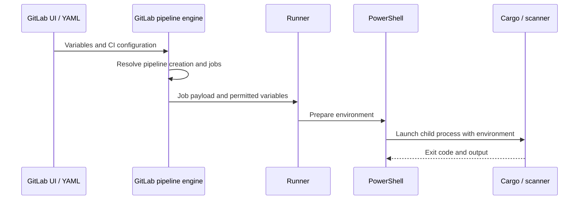

# Variables: concepts, scopes, and runtime boundaries

## What a CI/CD variable actually is
A GitLab CI/CD variable is a named value made available to a job, commonly as an environment variable. It is not necessarily a secret: `CARGO_TERM_COLOR=always` is configuration; `SONAR_TOKEN` is a credential. Keeping these categories separate is the first design decision. Variables are evaluated at different moments: GitLab evaluates pipeline configuration and rules; a runner receives the job payload; a shell expands environment references when executing commands. A value that exists during shell execution is not automatically usable when GitLab decides whether to create a job.

### Four boundaries to recognize

| Boundary | Example | Key question |
|---|---|---|
| Configuration parsing | `variables:` in YAML | Is this a literal, reference, or expansion? |
| Pipeline creation | `workflow:rules` | Is this variable available at evaluation time? |
| Runner execution | Windows shell environment | Did GitLab pass the variable to this job? |
| Application process | `cargo`, `sonar-scanner` | Did the child process inherit it? |



## Scope is not the same as secrecy
GitLab offers project, group, instance, pipeline and YAML-defined values, plus predefined CI variables. Project-level values are convenient for a single repository; group values support shared conventions across repositories; instance values require administrator governance. A YAML-defined variable is visible to anyone who can read that repository revision, so it is appropriate for non-secret defaults, not credentials.

```yaml
variables:
  CARGO_TERM_COLOR: "always"
  RUST_BACKTRACE: "1"

compile_windows:
  tags: [windows, rust]
  script:
    - 'Write-Host "Repository: $env:CI_PROJECT_PATH"'
    - 'cargo build --locked'
```

In PowerShell, `$env:NAME` reads an environment variable. This differs from Bash `$NAME`, and from GitLab's YAML-time `$NAME` references. The shell command's success still depends on the runner actually using a compatible Windows shell and having Cargo on its PATH.

## Environment scope versus project scope
An environment-scoped variable can apply only to jobs associated with a matching deployment environment. This is useful for staging and production endpoints, but the job must declare an appropriate `environment:`. Do not assume environment-scoped values will be available to all build or scan jobs. Wildcard matching and precedence deserve explicit review when multiple values share a name.

## Values are not necessarily strings you can print safely
File-type variables expose a temporary file path to the job, rather than placing the secret contents directly in the environment value. This is useful for certificates or configuration files. Masked or hidden variable options reduce accidental exposure, but cannot protect a credential against malicious job code with permission to access it.

### Design questions
- Does this value need to exist at pipeline creation or only when the job runs?
- Is it common to all projects, or does it belong to one repository?
- Can a contributor change the job script that reads it?
- Would a non-secret YAML default be sufficient?

## Conclusions
Think of variables as **data crossing configuration, authorization and process boundaries**. Name their owner, scope, availability phase and sensitivity before choosing where to store them. Never treat masking as an authorization boundary. See [project/group variables](02-project-group-and-instance-variables.md) and [secrets](04-secrets-masking-and-protection.md).
