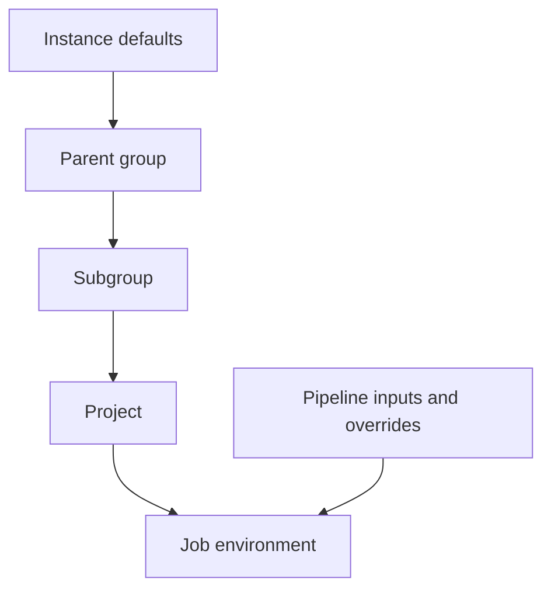

# Project, group, and instance variables

## Choosing an administrative home
A project variable belongs to one repository. A group variable can be inherited by projects in the group hierarchy. An instance variable is controlled at GitLab instance level and may apply broadly. The right choice is the narrowest scope that avoids excessive duplication without granting credentials to unrelated jobs.

| Location | Typical owner | Suitable example | Primary risk |
|---|---|---|---|
| Project | Project Maintainer | Project-specific scanner token | Repeated values across projects |
| Group | Group Owner or delegated role | Shared non-secret proxy endpoint | Broad inheritance |
| Instance | GitLab administrator | Fleet-wide configuration | Large blast radius |

## Where to find the settings
For project values, open the project and navigate to **Settings → CI/CD → Variables** (expand the Variables section where needed). For group values, open the group and use **Settings → CI/CD → Variables**. Instance-level administration is typically under the administrator's CI/CD settings. Labels and capabilities vary by GitLab version and role. If a menu is absent, check access level before assuming the feature is missing.

### A concrete enterprise ownership example
A company has five Rust repositories. Each repository uses the same Nexus IQ server URL but a distinct application identifier. The group might define `NEXUS_IQ_URL` as a non-secret shared setting; each project defines its own `NEXUS_IQ_APP_ID`. Credentials should be scoped to the actual identity and repositories that need them, rather than sharing one broad token by default.

```yaml
scan_dependencies:
  stage: scan
  tags: [windows, security]
  script:
    - 'if (-not $env:NEXUS_IQ_URL) { throw "Missing NEXUS_IQ_URL" }'
    - 'if (-not $env:NEXUS_IQ_APP_ID) { throw "Missing NEXUS_IQ_APP_ID" }'
    - 'Write-Host "Nexus IQ configuration present"'
```

This snippet checks availability without printing a token. It does not perform an IQ evaluation. A production integration requires vendor-supported CLI or API behavior verified against the installed product version.

## Inheritance is a governance decision
A project may inherit variables from a parent group or subgroup. A child project can sometimes define a same-named value that overrides an inherited value, subject to GitLab's precedence rules. This flexibility can cause silent configuration changes. Avoid using generic names such as `TOKEN` across multiple integration owners. Prefer `SONAR_TOKEN`, `FORTIFY_TOKEN`, and similarly specific names.



The diagram illustrates inheritance paths, **not a complete precedence ordering**. Pipeline policy variables and pipeline-supplied values may outrank project and group values; consult the separate precedence chapter before resolving collisions.

## UI procedure without live access
To reason about adding a project variable: determine its name, value, type (variable or file), environment scope, protected status, visibility options, and who can edit it. Record whether the target branch is protected and whether a merge-request pipeline can receive the value. Review the variable's consumers in YAML before adding it.

## Common failure patterns
A variable configured at the group level may not reach a project because it is outside the inheritance hierarchy. A protected variable may be unavailable on an unprotected ref. An environment-scoped variable may be absent from a job with no matching `environment`. A job can also override a global YAML default unintentionally.

## Conclusions
Administrative scope and runtime availability are different concerns. Document the **owner, consumer, security classification and intended environment** for each enterprise variable. See [precedence](03-variable-precedence-and-expansion.md) and [roles](05-roles-permissions-and-access-control.md).
