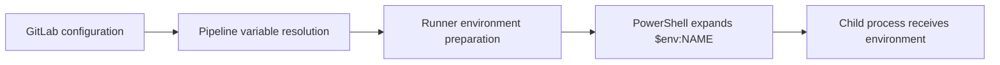

# Variable precedence and expansion

## Why precedence matters
A pipeline may receive the same variable name from multiple places. GitLab chooses an effective value according to a documented precedence hierarchy; it does not merge string values. This can be especially confusing when a job-level `variables:` block, a project UI value, and a manually supplied pipeline value all use the same name.

### Precedence, from higher to lower (verify against installed GitLab version)

1. Pipeline execution policy variables and scan execution policy variables, where applicable.
2. Pipeline variables, including manually supplied, trigger, schedule, API, downstream-forwarded and similar sources.
3. Project variables.
4. Group variables (nearest subgroup wins among group levels).
5. Instance variables.
6. Dotenv report variables.
7. Job-level YAML variables.
8. Top-level YAML default variables.
9. Deployment variables.
10. Predefined variables.

This hierarchy is a conceptual reading guide, not permission to override reserved predefined values. GitLab has evolved policy-variable ordering and pipeline-variable restrictions; check the version-specific documentation for production decisions.

## A collision example

```yaml
variables:
  RUST_LOG: "info"

check:
  variables:
    RUST_LOG: "debug"
  tags: [windows]
  script:
    - 'Write-Host "Configured log level: $env:RUST_LOG"'
```

If a project-level UI variable `RUST_LOG=warn` exists, the job can receive `warn`, even though YAML says `debug`, because the UI project variable has higher precedence. This surprises developers who assume a job-local declaration always wins.

| Source | Example value | Expected result in example |
|---|---|---|
| Top-level YAML | `info` | Overridden |
| Job YAML | `debug` | Overridden |
| Project UI | `warn` | Effective, absent higher sources |

## Expansion happens in different engines
GitLab may expand certain variable references before passing them to a runner. GitLab Runner also handles supported expansion, while the shell expands environment references at command execution. These stages do not share identical syntax or behavior. Expansion settings and masking restrictions have changed across versions, so do not assume `$A` in a UI variable will always expand to another variable's value.



### Windows-specific quoting
PowerShell expressions should use `$env:NAME`; single-quoted PowerShell strings do **not** expand variables, whereas double-quoted strings do. YAML quoting is a separate parser layer. For example, a YAML single-quoted scalar can contain a PowerShell double-quoted expression that PowerShell later expands.

```yaml
verify:
  tags: [windows]
  script:
    - 'Write-Host "Commit: $env:CI_COMMIT_SHORT_SHA"'
    - 'if (-not $env:SONAR_HOST_URL) { throw "SONAR_HOST_URL missing" }'
```

Avoid `Write-Host $env:SONAR_TOKEN` and other secret output. For debugging, print whether a value exists, not its contents or length if that might leak information.

## Diagnosing an unexpected value
First identify the variable name and job. Check whether a higher-priority pipeline source supplied it, then project and group UI definitions, then job/global YAML. Verify environment scope and protected status. Finally inspect the shell's expansion rules and whether a script changes the environment locally. Never assume the value visible in a UI is necessarily the value delivered to a given job.

## Conclusions
Precedence answers **which source wins**; expansion answers **when references become values**. Keep these questions separate. Avoid name collisions, document deliberate overrides, and prefer explicitly named integration variables.
