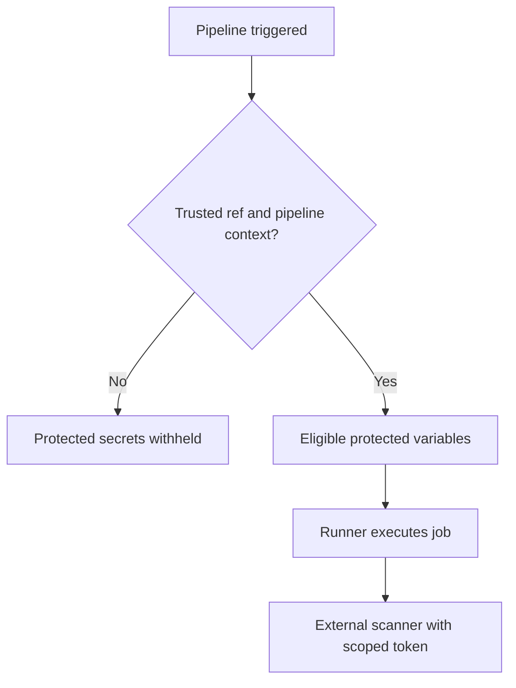

# Secrets, masking, protection, and trust boundaries

## A secret is a capability
A token does more than configure a scanner: it authorizes actions against another system. A CI job that receives a token effectively receives some of that token's authority. Security therefore depends on who can change the job code, which refs may run the job, what the token can do, and where the job executes.

### GitLab visibility options are not interchangeable

| Mechanism | Helps with | Does not guarantee |
|---|---|---|
| Masked variable | Redacts matching values in job logs when constraints are met | Protection against deliberate exfiltration |
| Hidden variable | Prevents later revealing value in UI | Safety from scripts that use the value |
| Protected variable | Restricts availability to eligible protected refs | Least privilege on external service |
| File-type variable | Supplies a temporary file path | Automatic confidentiality of file contents |
| Environment scope | Limits availability to matching environment jobs | Protection if jobs are misconfigured |

Masking is best-effort log hygiene. A malicious script can transform a value, send it to a network endpoint, or expose it indirectly. Do not run untrusted merge-request code with high-privilege credentials.

## Protected branches and pipeline trust
A protected variable is generally available only to eligible pipelines on protected refs, with additional conditions for merge-request scenarios. A job targeting `main` is not automatically trusted merely because its name includes `production`. Review the actual protected branch/tag settings and the rules controlling who can push or merge.



## Practical design for scanner credentials
Use separate tokens for SonarQube, Nexus IQ and Fortify. Prefer service identities with the narrowest required permissions and short lifetimes when supported. Store the value in a GitLab secret facility or an approved external secrets manager, not in YAML. Make token rotation and revocation part of operational ownership.

```yaml
sonar_review:
  stage: scan
  tags: [windows, security]
  rules:
    - if: '$CI_COMMIT_BRANCH == $CI_DEFAULT_BRANCH'
  script:
    - 'if (-not $env:SONAR_TOKEN) { throw "SONAR_TOKEN not available" }'
    - 'Write-Host "Token present; scanner invocation is documented separately"'
```

This illustrates a non-disclosing preflight, not a complete secure scan. The branch rule alone does not enforce protected-ref trust, and an environment-scoped secret may require `environment:` on the job.

## File variables and certificates
A file-type variable may carry a trusted CA certificate or tool configuration. The environment variable contains the path to a temporary file. Windows tools may expect PEM, PFX, JKS or another format; supplying the wrong format or using Bash path syntax is a common failure. Validate the file's expected encoding and the scanner's certificate-loading behavior without printing sensitive contents.

## Threat model checklist
Who can edit `.gitlab-ci.yml`? Who can approve merges? Can forks or untrusted merge requests reach this job? Is the runner shared with other tenants? Does the token allow only read or scan submission, or broader administration? Are logs, artifacts and caches accidentally capturing credential files? Is outbound network access restricted?

## Conclusions
Secure variables require **trusted code, trusted execution context, limited external authority, and safe storage**. Masking and hiding are useful but insufficient. For role-level decisions see [access control](05-roles-permissions-and-access-control.md).
