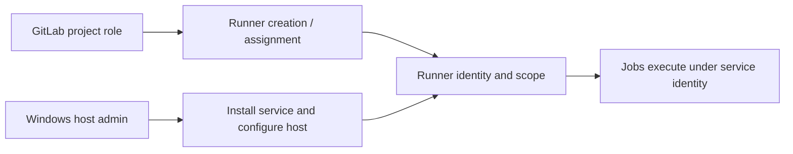

# GitLab roles, permissions, and access control

## Roles answer different questions
GitLab project roles commonly include Guest, Planner (where available), Reporter, Developer, Maintainer and Owner at group level. GitLab administrators have instance-wide capabilities. Some capabilities depend on edition, version, project settings, group ownership and custom roles. Never assume a single fixed permissions table applies to every enterprise installation.

### Practical permission orientation

| Operation | Typical minimum / owner | Verification caveat |
|---|---|---|
| Read project CI configuration | Access to repository contents | Private project membership matters |
| View pipeline/job details | Project access with appropriate role | Protected job/log restrictions may apply |
| Edit `.gitlab-ci.yml` | Repository write permission | Protected branches may require merge approval |
| Manage project CI/CD variables | Typically Maintainer | Check current GitLab permissions |
| Manage group CI/CD variables | Typically Group Owner | Delegated/custom roles may differ |
| Create project runner | Typically Maintainer | Runner creation may be restricted by admin settings |
| Create group runner | Typically Group Owner | Group policy may restrict |
| Create instance runner | Administrator | Instance settings govern availability |
| Modify local runner `config.toml` | OS-level access to runner host | GitLab project role alone is insufficient |

The table is an orientation, not an authorization guarantee. In particular, **viewing project settings**, **editing variables**, **creating a runner object**, and **installing a Windows service** are separate permissions.

## GitLab authorization versus Windows authorization
GitLab can authorize someone to create a runner or associate it with a project. It does not grant them administrator privileges on the Windows host. Installing a service, editing `config.toml`, configuring a service account, or changing local filesystem ACLs requires appropriate Windows permissions.

## Repository permissions are part of CI security
A Developer might be able to edit YAML on a feature branch, but not push directly to a protected default branch. A Maintainer may manage project CI/CD variables, yet the organization can impose approval rules or custom controls. The real security question is whether a contributor can cause unreviewed code to run in a context with sensitive variables.

## Runner management is not one operation
Distinguish creating a runner configuration in GitLab, obtaining its authentication token, registering a runner manager on Windows, selecting tags, allowing untagged jobs, and assigning protected status. Legacy registration tokens have been replaced in modern workflows by runner authentication tokens; follow the version-specific registration procedure and never copy an old command without checking deprecation status.

## How to request access efficiently
Instead of requesting 'admin access', name the operation: 'view the project CI/CD variable names', 'edit the protected `SONAR_TOKEN` variable', 'create a project runner', or 'read Windows Runner service logs'. Identify the project/group and expected duration. Separate GitLab access requests from Windows host access and external scanner permissions.

### Example access review
A developer needs to update a job's runner tag. That change usually lives in `.gitlab-ci.yml`, so repository write access and branch protection policy are central. They do **not** need Windows admin rights unless the runner itself must be reconfigured. If the runner does not exist, runner creation and host registration become separate activities.

## Conclusions
Enterprise CI/CD permissions span GitLab repository governance, CI settings, runner scope, Windows host privileges and scanner-side roles. Request the narrowest operation-specific capability and verify the installed GitLab version before relying on a permissions assumption.
