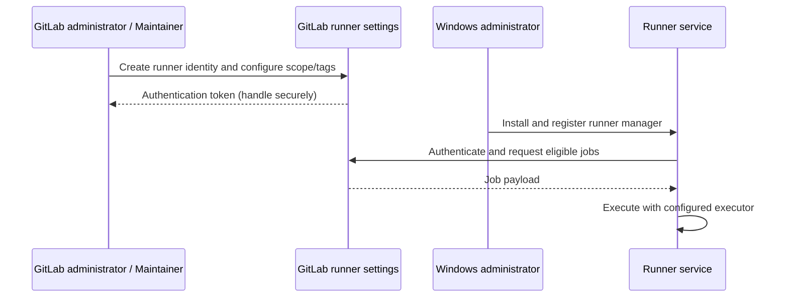

# Runner and project administration: boundaries and procedures

## Runner identity versus runner machine
A runner is represented in GitLab by a runner configuration and one or more runner managers. A Windows machine running `gitlab-runner.exe` acts as a manager for that runner identity. GitLab-side administration controls scope, tags, pause/protection and job eligibility; Windows-side administration controls the service, executor, shell, filesystem, certificates and toolchain.



## Project, group and instance runners
Project runners are intended for specific projects; group runners can serve projects in a group; instance runners may serve many projects according to instance policy. Wider scope increases utilization but also increases isolation and credential risks. For Windows Shell executors, jobs run on the host rather than in a fresh container, making shared-runner trust particularly important.

| Decision | Project runner | Group runner | Instance runner |
|---|---|---|---|
| Typical ownership | Project team | Platform/group team | Central platform team |
| Isolation potential | Easier to dedicate | Shared within group | Widest sharing |
| Configuration drift | More instances to maintain | Centralized group standards | Centralized fleet standards |
| Credential exposure concern | Project contributors | Multiple projects | Many projects |

## What goes in YAML and what does not

```yaml
windows_build:
  stage: build
  tags: [windows, rust]
  script:
    - 'Write-Host "Workspace: $env:CI_PROJECT_DIR"'
    - 'cargo build --locked'
```

This YAML selects an eligible runner by tags and defines job behavior. It does **not** install Rust, select a Windows service account, configure runner concurrency, or set the runner's build directory. Those are host and `config.toml` responsibilities. Tags are labels for matching; they do not prove the operating system or toolchain exists.

## A conceptual Windows host configuration

```toml
concurrent = 2

[[runners]]
  name = "windows-rust-runner"
  executor = "shell"
  shell = "powershell"
```

This is an illustrative fragment, not a complete registration-generated `config.toml`. Actual runner authentication, URLs and runner-specific options are created or configured during registration and must not be fabricated. The Windows service account must have permissions to work directories, cache directories and installed tools.

## Operational review procedure
When a job remains pending, inspect its tags, protected-ref status, project runner availability, pause state and concurrency. When it starts but fails immediately, inspect the host's PowerShell availability, working directory, PATH, Git/Cargo installation, permissions and TLS trust. Distinguish scheduling failures (GitLab) from execution failures (runner/host).

## Conclusions
Runner administration crosses two planes: GitLab **control-plane eligibility** and Windows **execution-plane capability**. Do not troubleshoot one as if it were the other. For detailed access rules see [roles](05-roles-permissions-and-access-control.md).
