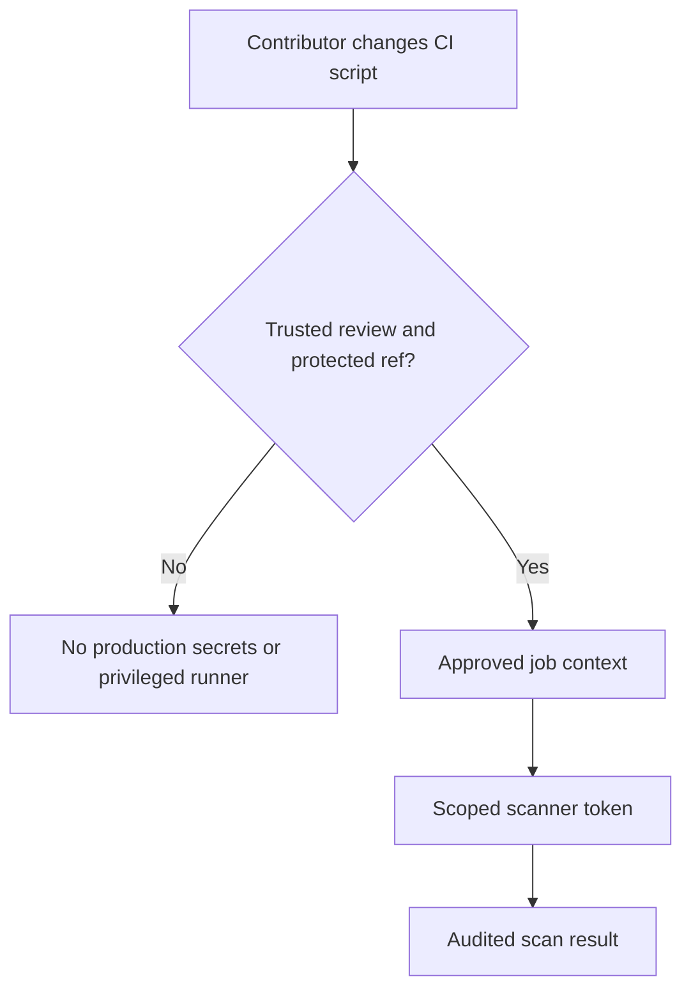

# Enterprise CI/CD security and governance

## Governance begins with boundaries
A pipeline is an automation identity with access to source code, credentials, artifact repositories and security systems. An enterprise must decide which team owns each identity and what changes require review. GitLab roles, branch protection, runner scope, variable access and external scanner permissions should reinforce one another rather than be configured independently.

### Security control map

| Boundary | Primary control | Evidence to review |
|---|---|---|
| Source changes | Protected branches, merge approvals | Who approved CI YAML changes? |
| Pipeline execution | Rules and trusted ref policies | Which pipeline source ran? |
| Secret delivery | Protected/environment-scoped variables | Which jobs were eligible? |
| Runner host | Service identity and filesystem ACLs | Which account ran scripts? |
| External systems | Scoped tokens and network policy | What could scanner credentials do? |
| Outputs | Artifact/cache retention and access | Did files contain sensitive material? |

## Threat scenario: untrusted merge request
A contributor changes `.gitlab-ci.yml` to print a credential or upload it to a remote host. Masking may hide a literal value in logs, but cannot prevent arbitrary exfiltration. The protective controls are to withhold protected credentials from untrusted pipeline contexts, require review for CI configuration changes, and restrict network and token privileges.

## Separation of duties
The developer owns the intended pipeline behavior. The platform team may own runner registration and host maintenance. Security owns scanner policy and acceptable findings. Release management may control production environments. These roles can overlap in small teams, but responsibilities should remain explicit.

## Governance for Rust dependency supply chain
`Cargo.lock` records resolved dependencies and is normally committed for applications. Use `cargo build --locked` in CI to detect unreviewed lockfile drift. A private registry or artifact proxy can improve control, but introduces authentication, TLS and availability dependencies. Nexus IQ policy evaluation and Cargo dependency resolution are distinct activities; a successful build does not prove dependency policy compliance.

## Evidence and auditability
Retain pipeline job metadata, scanner reports, relevant logs and approval records according to policy. Avoid storing credentials in artifacts or caches. A green GitLab job can mean a scanner command returned success; it does not by itself prove the tool evaluated the intended application, branch or policy stage. Define explicit acceptance evidence for each integration.

## Change control example
Suppose a team wants to change the Windows Runner tag from `windows` to `windows-secure`. The code review should identify whether a matching runner exists, whether it is protected, what identity it runs under, whether it has Cargo and scanners installed, and whether job concurrency or cache behavior changes. The tag edit is small; its security and operational consequences are not.

## Conclusions
Enterprise readiness means knowing both **how to make a configuration work** and **which organizational controls make it safe**. Review CI YAML, secrets, runner hosts and external scanner permissions as one connected trust system. See [secrets](04-secrets-masking-and-protection.md) and [administration](06-runner-and-project-administration.md).
