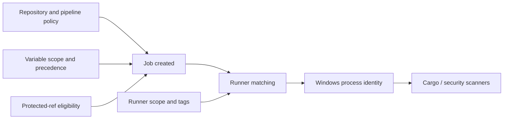

# P4 synthesis: variables, permissions, and readiness validation

## The central mental model
A GitLab job is created from CI configuration, receives an authorized set of variables, is matched to an eligible runner, and executes scripts under a runner host identity. Variable precedence determines effective values; protected scopes determine whether values may be delivered; project and group roles determine who may administer settings; Windows permissions determine what the resulting process can do. These controls are related but not interchangeable.



## Five distinctions worth remembering

| Often confused | Correct distinction |
|---|---|
| Project variable vs YAML variable | UI-managed values often outrank YAML and can be secret |
| Masked vs protected | Log redaction is not ref-based authorization |
| Runner tag vs executor | Tag matches jobs; executor determines how they run |
| GitLab Maintainer vs Windows admin | Repository/platform permissions are separate |
| Secret present vs safe to use | Availability does not imply least privilege or trusted code |

## L1 — Understand: explain the system
Given a pipeline with `variables:`, a job with `tags: [windows]`, and a project-level `SONAR_TOKEN`, explain where the token is stored, how the job becomes eligible to receive it, which actor chooses the runner, and how PowerShell accesses it. A strong answer separates pipeline creation, runner matching, secret eligibility and shell expansion.

### L1 questions
1. Why does a variable configured in GitLab UI not necessarily appear in every job?
2. Why can a job-level YAML value lose to a project UI value?
3. Why does `tags: [windows]` not guarantee Windows execution?
4. Why is masking insufficient to protect against malicious scripts?

## L2 — Modify: make a safe change
A project has `SONAR_TOKEN` configured at group scope, but only the default branch should run a privileged analysis. Describe the changes needed to the job rules, protected-ref policy, variable protection and scanner-side token scope. State which parts require repository access, GitLab settings permissions and external scanner administration. Do not solve the problem by embedding the token in YAML.

```yaml
quality_scan:
  stage: scan
  tags: [windows, security]
  rules:
    - if: '$CI_COMMIT_BRANCH == $CI_DEFAULT_BRANCH'
  script:
    - 'if (-not $env:SONAR_TOKEN) { throw "Missing SONAR_TOKEN" }'
    - 'Write-Host "Preflight passed"'
```

This is an illustrative preflight only. The branch rule does not replace protected branch configuration, and no actual scanner runs here.

## L3 — Troubleshoot: follow evidence
A job runs successfully on a feature branch but reports that `SONAR_TOKEN` is missing. Hypotheses include protected variable restrictions, environment scope mismatch, a variable name typo, or pipeline context differences. Check the variable's metadata without revealing its value, the ref protection state, job environment declaration, pipeline source and applicable GitLab version. Do not immediately disable protection to 'fix' the failure.

### Evidence checklist
- [ ] Identify exact project, branch/tag, pipeline source and job.
- [ ] Identify whether the variable is project, group, instance or pipeline supplied.
- [ ] Check precedence and collisions without exposing values.
- [ ] Check protected-ref and environment-scope eligibility.
- [ ] Verify job runner tags and runner scope.
- [ ] Distinguish GitLab permissions from Windows service privileges.
- [ ] Identify token owner, purpose and revocation path.
- [ ] Confirm artifacts, logs and caches do not leak secrets.

## Readiness criteria
**L1 pass:** Explain all five distinctions and the variable-delivery flow without confusing GitLab, runner and shell responsibilities. **L2 pass:** Propose a safe change with correct configuration ownership and least-privilege assumptions. **L3 pass:** Provide at least three plausible hypotheses, prioritize evidence collection, and propose a correction that preserves security controls.

## Conclusions
P4 is not simply a lesson about adding variables in a UI. It is about how configuration, authorization and execution identities intersect. In real enterprise work, begin with the intended operation and its trust boundary; only then choose the setting, role, variable scope or runner configuration. Live access checks and implementation remain deferred.
