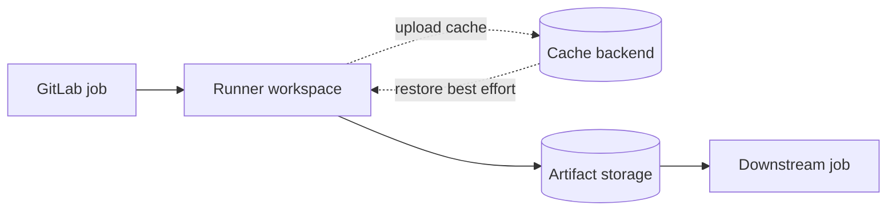

# Cache and artifacts: two different contracts

## The problem: jobs do not share a reliable workspace

A GitLab job is an independently scheduled unit of work. A second job may execute on another Windows machine, in a different directory, or after the first job's workspace has been cleaned. Files present in one job are **not automatically available** to another. GitLab provides two mechanisms that solve different problems: caches accelerate repeated work; artifacts transfer and retain results.

### Cache: an optimization, not a dependency

A cache stores reusable inputs or derived files, such as downloaded Cargo registry packages. A job can restore a matching cache before its script runs, and upload a changed cache afterward, depending on policy. Cache availability is not guaranteed: a key can be absent, an archive can expire, or runners can use different storage backends. Therefore a correct build must still work on a cache miss.

### Artifact: a declared job output

An artifact is produced by a job and uploaded to GitLab-managed artifact storage. Subsequent jobs can download it when configured to do so. Typical artifacts include a compiled executable, test results, a coverage report or an SBOM. Artifacts are appropriate for *passing results*, not for accelerating dependency downloads.

| Question | Cache | Artifact |
|---|---|---|
| Primary purpose | Speed | Transfer or retention |
| Identity | Cache key | Producing job/pipeline |
| Guaranteed hit? | No | Subject to successful upload, access and expiry |
| Typical Cargo content | Registry downloads | Binary, report, package |
| Ownership | Runner/cache backend | GitLab artifact service/storage |
| Security | Treat as untrusted reuse | Treat as produced output; control access |

## A conceptual data flow



### Why `target/` is ambiguous

Rust's `target/` directory holds compiler outputs, incremental state and executables. Caching it can save compilation time but creates large archives and compatibility risks when toolchains, build flags or targets change. Uploading a selected executable as an artifact is usually clearer than uploading the entire `target/` tree.

## Example: separate intent in YAML

```yaml
build:
  tags: [windows, powershell]
  cache:
    key: "cargo-$CI_COMMIT_REF_SLUG"
    paths:
      - .cargo/registry/
  script:
    - cargo build --locked --release
  artifacts:
    paths:
      - target/release/myapp.exe
    expire_in: 7 days
```

This is illustrative: the executable path must match the actual package and target, and the cache directory must be populated by a correctly configured `CARGO_HOME`.

## Enterprise conclusion

Ask two questions before writing `cache:` or `artifacts:`: **Would losing this file merely slow the job?** Use a cache. **Does another job or reviewer need this exact output?** Use an artifact. Never use a cache as the only way to deliver a release binary.

### Check your understanding

Explain why a cache hit is not proof of correctness, and why an artifact's retention period matters for auditability.
