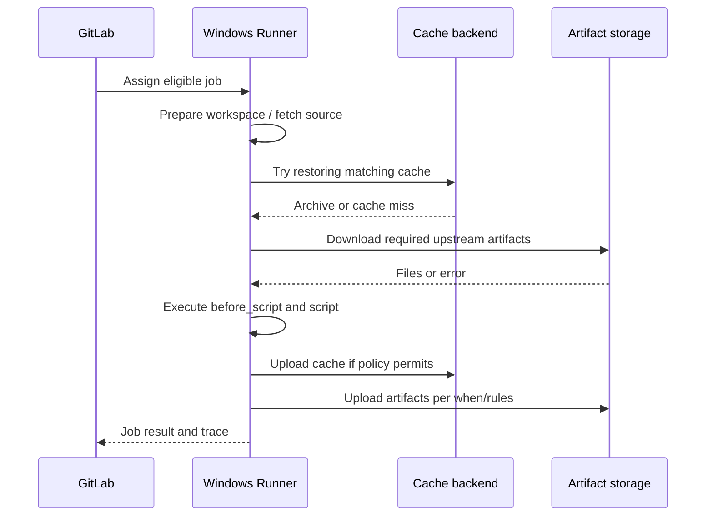

# Job and pipeline data lifecycle

## Distinguish the four storage locations

GitLab CI data moves among the repository, a job workspace, cache storage and artifact storage. These locations have different lifetimes and ownership. A Windows shell runner can reuse a host and build directory, but **host reuse does not imply a safe shared workspace**.

## Lifecycle phases

### 1. Source checkout

The runner prepares a working directory and checks out the pipeline's commit. A shallow clone or different Git strategy can affect files and metadata. The exact workspace path is exposed through `CI_PROJECT_DIR`; hard-coded `C:\builds\...` paths are fragile.

### 2. Cache restoration

GitLab Runner evaluates the job's cache configuration and attempts to retrieve matching archives. Restoration occurs before the main script. A miss should not fail a correctly designed build.

### 3. Artifact retrieval

When jobs depend on earlier outputs, GitLab Runner downloads appropriate artifacts. With `needs`, artifact downloads are controlled by `needs:artifacts`; do not assume stage order alone determines every transfer in a DAG pipeline.

### 4. Script execution

On a Windows Shell executor, commands run in a generated PowerShell script under the runner service's account. Environment variables are visible as `$env:NAME`. The job may write to the workspace, but local filesystem state is not a portable communication channel between jobs.

### 5. Upload and cleanup

Caches and artifacts are uploaded according to their configurations and job outcomes. `after_script` runs in a separate shell context; changes made there to environment variables do not carry backward into `script`. Files created in `after_script` can be included in uploads if paths and timing permit.

## Within-job versus cross-job reuse

Within one job, consecutive `script` commands can read files created earlier in that job. Across jobs, explicitly declare artifacts for required results. Across pipelines, use a cache for optimization, or publish versioned packages to a registry for durable release consumption.

## Windows-specific implications

| Concern | Practical rule |
|---|---|
| Path separator | Prefer relative `/` paths in YAML; PowerShell accepts platform paths |
| Working directory | Use `$env:CI_PROJECT_DIR` in scripts |
| Service identity | Verify file permissions for the runner service account |
| Parallelism | Never assume two jobs have the same workspace |
| Cleanup | Do not rely on files surviving the job |

## Failure analysis

If a downstream test job cannot find `myapp.exe`, inspect the producing job's artifact upload log, the artifact path relative to the checkout, its expiry, and the downstream `needs` declaration. Do not solve this by making the two jobs share a Windows directory.

### Conclusion

Think of each job as a fresh consumer of declared inputs. The repository is source input; cache is optional acceleration; artifacts are explicit outputs; registries are for durable published packages.
