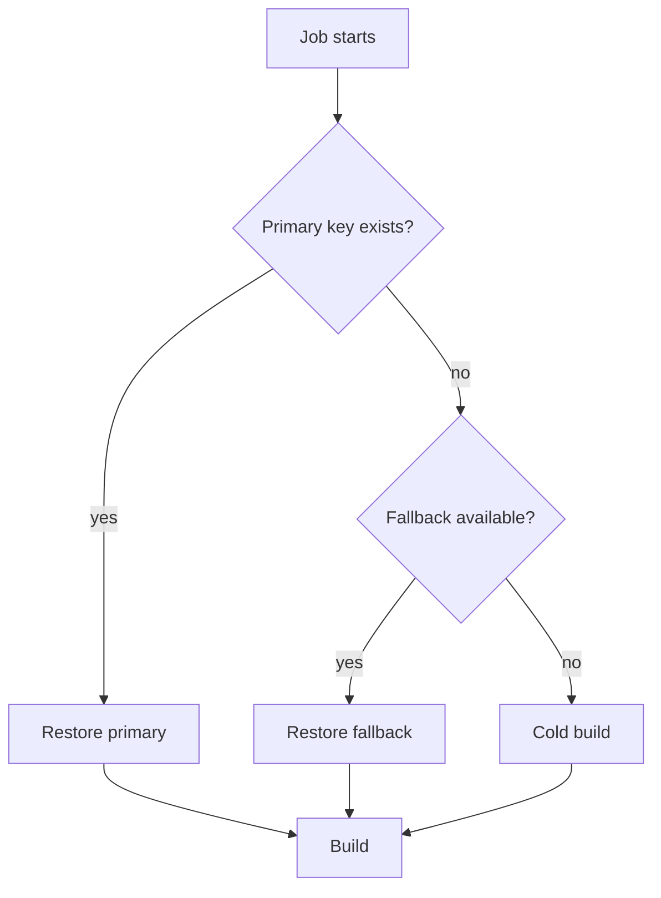

# Cache keys, policies and invalidation

## A cache key defines compatibility

A cache key identifies a reusable archive. A poorly chosen key either produces too many misses (little acceleration) or shares incompatible content (hard-to-reproduce failures). Cache keys should reflect the dimensions that matter: dependency lockfile, Rust toolchain, OS, target triple, build profile and sometimes branch trust boundary.

### Key strategies

| Strategy | Benefit | Risk |
|---|---|---|
| Per branch | Isolates development branches | Duplicates downloads |
| Lockfile-derived | Invalidates on dependency change | Toolchain differences may remain |
| Shared default branch | High reuse | Writers can interfere |
| Toolchain + lockfile | Better compatibility | More cache entries |

GitLab supports `cache:key:files` for keys derived from repository files. It is useful for `Cargo.lock`, but not a complete substitute for considering platform and compiler differences.

```yaml
default:
  cache:
    key:
      prefix: "win-rust-stable"
      files:
        - Cargo.lock
    paths:
      - .cargo/registry/
    policy: pull

warm_dependencies:
  stage: prepare
  cache:
    key:
      prefix: "win-rust-stable"
      files: [Cargo.lock]
    paths: [.cargo/registry/]
    policy: pull-push
  script:
    - cargo fetch --locked
```

The example assumes `.cargo/registry/` is under the project directory and `CARGO_HOME` points there. On Windows, check how the runner shell resolves variables and paths before copying a Linux example.

## `pull`, `push`, `pull-push`

- `pull`: restore but do not upload; appropriate for many consumers.
- `push`: upload but do not restore; useful for a deliberate producer.
- `pull-push`: restore and update; convenient but can cause multiple jobs to overwrite the same key.

A single cache writer and multiple readers often provides more predictable behavior than every job writing the same cache key.

## Invalidation and fallback

A dependency update changes `Cargo.lock`, so a file-derived key changes and old cache entries are not reused. A compiler upgrade may require changing a static key prefix. GitLab also supports fallback keys, but fallback is a performance mechanism: using an older archive must not be necessary for correctness.



## Security boundaries

Protected and non-protected references may have separate cache namespaces, depending on GitLab settings. Do not design a pipeline that lets untrusted merge-request code poison a privileged release cache. Cache archives can contain executable build scripts or other untrusted files; validation remains essential.

## Debugging a cache miss

Read the runner log for the resolved key, restore attempt, backend availability and upload result. Confirm the cached path is inside the project directory, exists at upload time, and is not excluded by the cache policy. A miss caused by a changed key is often correct behavior.

### Conclusion

Treat key design as a compatibility contract and policy design as a writer/reader contract. Optimize after establishing reliable builds without caches.
