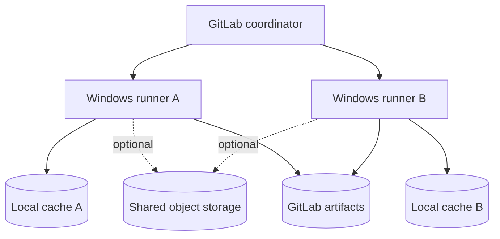

# Runner storage and distributed caching

## Local runner storage is not GitLab artifact storage

A runner's cache may be stored locally or in a configured distributed backend. The location matters when multiple runners execute jobs. Two Windows runners with only local caches do not automatically share archives, even when their GitLab cache keys are identical.

## Three deployment patterns

### One dedicated Windows runner

Local caching is simple and can be effective when the same runner processes related jobs. It still must be treated as optional: a cleanup, cache-key change or runner reinstall can remove it.

### Multiple Windows runners without shared cache

A job may hit a warm cache on runner A and miss on runner B. This is normal and should be expected. Avoid diagnosing this as a GitLab YAML bug without examining the runner topology.

### Multiple runners with distributed cache

A compatible shared backend can improve hit rates across runners. It adds configuration, credentials, network traffic and operational ownership. GitLab Runner distributed cache configuration belongs on the runner side, generally in `config.toml`, not in `.gitlab-ci.yml`.

## Configuration boundaries

| Setting | Typically belongs to |
|---|---|
| Cache key, paths, policy | `.gitlab-ci.yml` |
| Runner executor and service account | Windows host / `config.toml` |
| Distributed cache backend credentials | Runner-side secure configuration |
| Artifact expiry | `.gitlab-ci.yml` |
| GitLab artifact storage | GitLab server administration |

The Shell executor's filesystem is not an isolation boundary comparable to an ephemeral container. A malicious or misconfigured job may access host resources available to the runner service account. Restrict which projects can use sensitive runners.

## Performance tradeoffs

Caching a multi-gigabyte `target/` directory may cost more in compression and network transfer than rebuilding. Registry downloads are often smaller and more portable. Measure restore time, archive size, hit rate and compilation time rather than assuming more cached files means faster pipelines.

### Incident scenario: intermittent slow builds

Two jobs with the same key run on two different Windows hosts. One restores a cache, the other reports a miss. Verify runner identities, backend configuration and cache paths. If the runners use independent local storage, the result is expected. Options include distributed caching, dedicated runner affinity where appropriate, or accepting occasional cold builds.

## Conclusion

GitLab schedules jobs; runners own execution; cache storage determines whether reuse is physically possible. Keep the data-plane architecture visible when troubleshooting performance.
