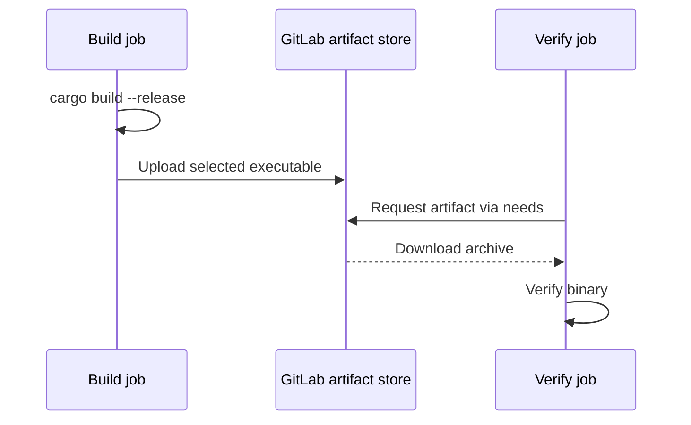

# Artifact creation, transfer and retention

## Artifacts express output contracts

An artifact is a job-produced file or directory that GitLab retains for later retrieval. It is useful for binaries, test reports, coverage files, security reports and diagnostic bundles. An artifact's path is relative to the job workspace; a file that exists elsewhere on the Windows host will not be uploaded simply because the job can read it.

## Producer and consumer

```yaml
stages: [build, verify]

build_windows:
  stage: build
  tags: [windows, powershell]
  script:
    - cargo build --locked --release
  artifacts:
    name: "windows-build-$CI_COMMIT_SHORT_SHA"
    paths:
      - target/release/myapp.exe
    expire_in: 1 week

verify_binary:
  stage: verify
  tags: [windows, powershell]
  needs:
    - job: build_windows
      artifacts: true
  script:
    - if (-not (Test-Path "target/release/myapp.exe")) { throw "Missing build artifact" }
```

The binary name is illustrative. A real Rust workspace may place outputs in another location, particularly when cross-compiling or using a custom target directory.



## Artifact options worth knowing

| Keyword | Effect |
|---|---|
| `artifacts:paths` | Select ordinary files/directories |
| `artifacts:expire_in` | Set retention duration |
| `artifacts:when` | Control upload based on job result |
| `artifacts:reports` | Supply structured reports for GitLab features |
| `needs:artifacts` | Control artifact downloads for DAG dependencies |

Not every security scanner's output is automatically a GitLab-native report. The report format must match what GitLab supports; otherwise publish it as a normal artifact or use the vendor's own reporting platform.

## Retention is not archival policy

Artifacts can expire, be manually deleted, or be subject to instance retention rules. Release packages that must be available long-term belong in an appropriate package registry or release storage, with explicit versioning and access controls. An artifact is not automatically an immutable supply-chain record.

## Troubleshooting

If upload says “no matching files,” inspect the workspace, filename, path casing, target triple and whether the file was created. If a consumer fails, inspect the producing job's success, artifact existence, `needs` configuration and retention. For a failed build that needs logs, use `artifacts:when: always` selectively and avoid uploading secrets.

## Conclusion

Artifacts are the reproducible handoff between independently scheduled jobs. Declare only the outputs that consumers need, control retention deliberately, and separate CI handoffs from durable release publication.
