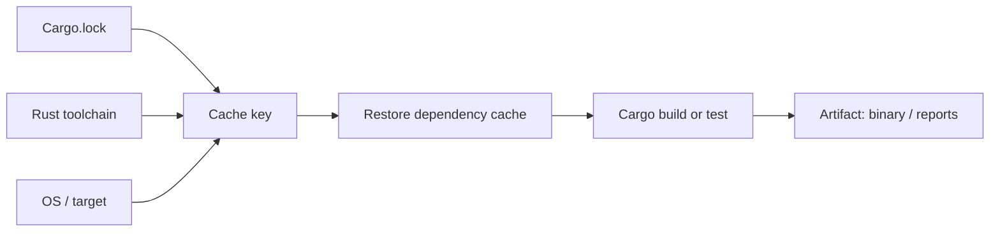

# Cargo caching and performance on Windows runners

## Know what Cargo writes

Cargo uses a home directory for registry indexes, downloaded crate sources and Git dependency checkouts. It also writes compilation outputs to `target/` (or a configured target directory). These are different kinds of data with different portability and invalidation characteristics.

| Directory | Typical contents | Cache suitability |
|---|---|---|
| `.cargo/registry/` | Registry index and downloaded crates | Usually useful |
| `.cargo/git/` | Git-sourced dependencies | Often useful |
| `target/` | Build outputs, incremental state | Conditional, potentially expensive |
| `target/release/*.exe` | Final executable | Prefer artifact |

## Make Cargo home project-relative

GitLab cache paths normally refer to the project directory. Cargo's default home on Windows may be under the service account's profile and therefore outside cacheable paths. Set `CARGO_HOME` to a project-relative directory and ensure the script sees the same location.

```yaml
variables:
  CARGO_HOME: "$CI_PROJECT_DIR/.cargo"

cargo_test:
  tags: [windows, powershell]
  cache:
    key:
      prefix: "windows-cargo"
      files: [Cargo.lock]
    paths:
      - .cargo/registry/
      - .cargo/git/
  script:
    - Write-Host "Cargo home: $env:CARGO_HOME"
    - cargo fetch --locked
    - cargo test --locked
```

Variable expansion and runner behavior can vary by version and executor; verify the effective `CARGO_HOME` in a real environment before relying on this example. It is documentation-only.

## Why caching `target/` is tricky

Compiler outputs depend on rustc version, target architecture, features, profile, environment and compilation flags. Reusing incompatible state can cause unnecessary recompilation or subtle confusion. Cache archives can also be large enough that uploading and downloading them costs more than rebuilding.



## Maven comparison

Maven's `.m2/repository` resembles Cargo's downloaded dependency storage more than Cargo's `target/` directory. Maven's `target/` and Cargo's `target/` both contain build products, but their structure and incremental compilation behavior differ. A cache strategy copied from Java without considering Cargo's layout can be inefficient.

## Optimization sequence

First establish a clean `cargo build --locked` and `cargo test --locked`. Then cache downloaded dependencies. Measure hit rates and job duration. Only then evaluate compiler-output caching or tools such as `sccache`, which require additional configuration and operational ownership.

## Failure modes

- Cache path empty: Cargo home is elsewhere.
- Cache key changes every pipeline: inspect key construction.
- Slow despite cache hit: compilation dominates, not downloads.
- Windows permission errors: runner service account lacks access.
- Different runner hosts: local caches are not shared.

### Conclusion

Optimize dependency retrieval first, compilation second, and release delivery separately. A cache is a performance feature, not a substitute for lockfiles or repeatable builds.
