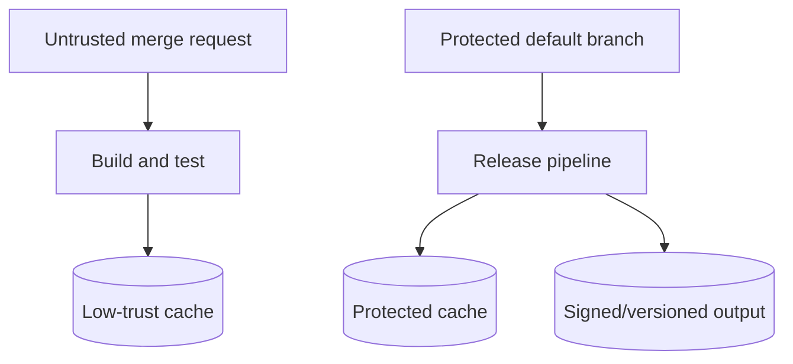

# Enterprise cache and artifact design patterns

## Design around trust, reproducibility and cost

A mature enterprise pipeline balances build speed against security and operational complexity. The fastest pipeline is not always the safest or easiest to reproduce. Cache and artifact decisions should follow ownership and trust boundaries.

## Pattern A: one writer, multiple cache readers

A dependency preparation job refreshes a shared cache; downstream jobs use `policy: pull`. This reduces simultaneous writes to the same key. It is useful when a cache backend is shared, but does not make a cache a guaranteed dependency.

## Pattern B: artifact handoff for build outputs

Build a binary once and pass it to verification, signing or packaging jobs using artifacts. This prevents independent jobs from silently rebuilding different outputs. Ensure artifacts are generated under the intended toolchain and controlled branch protections.

## Pattern C: separate untrusted and privileged pipelines

Merge-request code can execute arbitrary scripts. Do not expose protected secrets or writable privileged caches to untrusted code. Use protected branches, appropriate runner isolation and separate credentials for release jobs.

## Pattern D: publish durable outputs

Use CI artifacts for immediate pipeline-to-pipeline or job-to-job review where appropriate. Use a package or release registry for versioned deliverables with a defined retention policy. Record checksums, provenance and approval metadata when enterprise governance requires them.

## Decision matrix

| Requirement | Preferred mechanism | Why |
|---|---|---|
| Speed up Cargo downloads | Cache | Reusable optimization |
| Pass test report to GitLab | Artifact/report | Structured output |
| Pass binary to packaging job | Artifact | Exact job output |
| Keep release binary for months | Package/release registry | Durable versioned storage |
| Share compiler outputs across OS | Usually avoid | Compatibility risk |
| Protect privileged signing key | Protected secret mechanism | Not cache/artifact |

## Operational metrics

Track job duration, cache restore time, cache archive size, hit/miss ratio, artifact upload time and storage costs. Watch for jobs where archive transfer exceeds saved compilation time. Avoid over-optimizing before measuring.

## Common anti-patterns

Using one global cache key for all branches, placing credentials in cached directories, uploading the entire workspace as an artifact, assuming a runner-local file survives across jobs, and treating a cache miss as a pipeline failure.

### Conclusion

A good enterprise design makes the essential data path explicit and leaves caches optional. Favor reproducibility and least privilege over fragile performance shortcuts.
