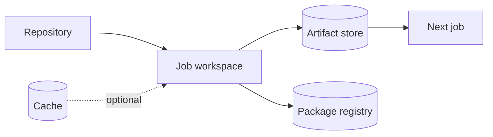

# P5 conclusions: caching and artifacts

## Synthesis of the conceptual model

GitLab jobs are isolated scheduling units even when a Windows Shell executor reuses a physical machine. Files have different roles: source files come from Git, optional reusable dependencies come from cache, job-produced deliverables come from artifacts, and durable published releases belong in a registry.

## The five decisions to make

1. **Is the file necessary for correctness?** If yes, do not rely solely on cache.
2. **Who consumes the file?** A later job suggests artifacts; a later release process may require a registry.
3. **What makes it compatible?** Choose keys that reflect lockfile, platform and toolchain boundaries.
4. **Who may write or read it?** Consider protected branches, runners and secret exposure.
5. **How long should it live?** Separate short-lived CI results from retained release records.

## Competency checklist

### L1 — Understand

- [ ] Explain why two jobs cannot assume a shared workspace.
- [ ] Differentiate cache restore from artifact download.
- [ ] Describe the sequence of checkout, cache restore, artifact retrieval, script and upload.
- [ ] Explain why a cache miss should not break a correct build.

### L2 — Modify

- [ ] Choose a cache key for a Cargo project with `Cargo.lock`.
- [ ] Configure project-relative Cargo cache paths.
- [ ] Add an artifact for a Windows executable.
- [ ] Connect a consuming job with `needs:artifacts`.
- [ ] Define an appropriate artifact expiry.

### L3 — Troubleshoot

- [ ] Diagnose “no matching files” on artifact upload.
- [ ] Explain a cache hit on one runner and miss on another.
- [ ] Distinguish invalid cache paths from incompatible cache keys.
- [ ] Identify unsafe sharing between untrusted and protected pipelines.

## Three review cases

**Case A: build succeeds but packaging cannot find the executable.** Inspect artifact path, producer upload, `needs`, target directory and expiry. Do not depend on a shared Windows folder.

**Case B: Cargo downloads dependencies on every job.** Inspect `CARGO_HOME`, cache paths, resolved key, policy, and backend accessibility. Compare cold and warm runs.

**Case C: a release job restores an archive written by an untrusted merge request.** Treat this as a trust-boundary problem, not merely a performance configuration. Isolate cache namespaces and review runner and branch protection.

## Practical conclusions

Caches improve throughput; artifacts express data dependencies; registries retain published versions. Configuration lives in multiple places: `.gitlab-ci.yml` declares job behavior, `config.toml` governs runner-side cache backend details, and GitLab server settings influence artifact storage and permissions.

The recommended learning order is to understand the lifecycle, study keys and policies, learn artifact transfer, examine runner topology, and finally optimize Cargo builds. Live labs can remain deferred while these decisions are practiced through configuration reviews and log analysis.

## Further study

Continue with P6 Windows GitLab Runners to understand how executor identity, filesystem paths and distributed cache configuration affect the behavior described here. Revisit P3 job graphs and P4 protected variables when reasoning about security and downstream artifact consumers.
