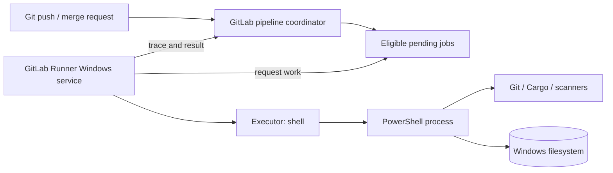

# Windows GitLab Runner: architecture and boundaries

## What a runner actually is

GitLab coordinates pipelines, evaluates rules and offers eligible jobs to runners. **GitLab Runner** is a separately installed agent that requests work, prepares an execution environment, runs scripts, and reports logs and status. Installing a runner on Windows does not turn GitLab into a Windows build server: the runner host owns its operating system, tools, service identity, storage, and network connectivity.

A runner configuration is associated with a runner record in GitLab. One runner installation can contain multiple runner configurations, but this does not automatically create separate Windows security boundaries. The distinction matters when an organization uses the same machine for ordinary feature builds and privileged release jobs.

## Four responsibilities

| Component | Responsibility | What it does not guarantee |
|---|---|---|
| GitLab server | Pipeline creation, authorization, job metadata | Tool availability on Windows |
| Runner agent | Polling, job preparation, transfer, reporting | Sandboxed execution for Shell executor |
| Executor | How commands run | Correct project permissions |
| Windows host | Accounts, ACLs, PATH, certificates, installed tools | GitLab job eligibility |

The term *runner* is overloaded: GitLab's runner record, the installed agent, and a specific runner configuration are related but not identical. When debugging, identify which layer is failing.

## Runner scope is not host isolation

A **project runner** is assigned to specific projects; a **group runner** serves eligible projects within a group; an **instance runner** can serve a wider set of projects. Scope controls where jobs may be assigned. It does not isolate processes once jobs execute under the same Windows service account. Eligibility also depends on tags, runner status, protected status and project settings.

## Push versus polling

A Git push can create a pipeline, but GitLab does not simply execute arbitrary PowerShell on the server. The runner requests jobs from GitLab, receives a job payload, and carries out the lifecycle. This distinction explains why a pipeline may exist while its jobs remain pending: pipeline creation succeeded, but no eligible runner accepted the job.

## Java analogy

Think of GitLab as the scheduler and the Windows runner as an external worker process. It resembles a queue consumer more than a Maven plugin. Cargo, like Maven, is a build tool invoked *inside* the worker; neither Cargo nor Maven decides which runner gets a GitLab job.

## Architectural review questions

1. Who administers the Windows VM and its service account?
2. Which projects and refs can schedule jobs on it?
3. Is the Shell executor acceptable for the trust level of those projects?
4. Which team maintains Cargo, Git, scanner versions and certificates?
5. Where are cache archives, job traces and artifacts stored?

**Key principle:** GitLab permissions determine who may schedule work; Windows permissions determine what that work can access after it starts. Both must be reviewed.
