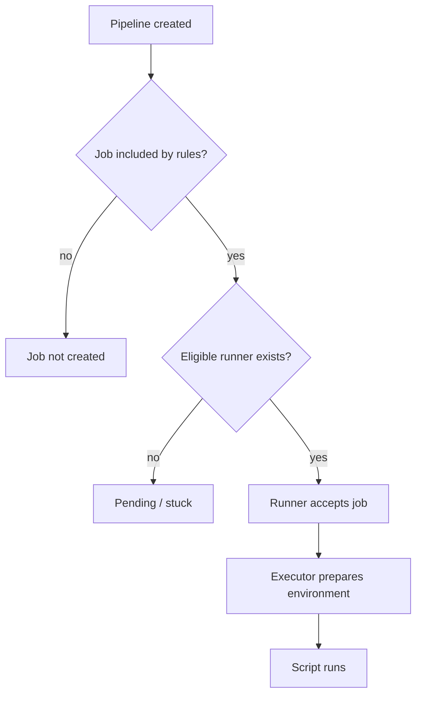

# Executors and job assignment

## Assignment happens before execution

A valid `.gitlab-ci.yml` can produce a job that never starts. GitLab first determines whether the job belongs in the pipeline, then whether an available runner is eligible. Only after assignment does the runner's executor matter. This separation prevents two common misdiagnoses: treating `rules` problems as runner failures, and treating missing host tools as scheduling failures.



## Eligibility dimensions

Runner scope, enabled/paused state, matching tags, whether untagged jobs are accepted, protected runner restrictions, and available concurrency all affect assignment. For tagged jobs, the runner must satisfy **all** job tags, not just one. A runner tagged `windows` does not match a job requiring both `windows` and `rust` unless it has both tags.

```yaml
rust_windows:
  tags:
    - windows
    - rust
  script:
    - cargo --version
```

This snippet selects by tags; it does not provision Rust or prove that the executor is Windows. Tags are administrator-defined labels, not verified host capabilities.

## Executors compared

| Executor | Isolation model | Windows implication |
|---|---|---|
| Shell | Direct processes on runner host | Common for installed MSVC toolchains; low isolation |
| Docker | Containers | Requires compatible Docker/Windows container environment |
| Kubernetes | Pods scheduled by cluster | Different operational ownership |
| Custom | User-provided execution integration | Requires substantial maintenance |

For this handbook, the principal scenario is **Windows Shell executor**. It executes generated PowerShell scripts as processes on the Windows machine, typically under the account running the runner service. A Linux Docker example cannot be copied blindly: paths, command syntax, installed tools, and process isolation differ.

## Scheduling versus local capacity

A runner may be eligible but busy. The global `concurrent` limit applies across configured runners in a runner process, while per-runner `limit` can constrain a particular configuration. The GitLab coordinator also manages scheduling and availability. If a job waits, inspect whether it is stuck for eligibility or simply queued for capacity.

## Diagnostic sequence

First confirm the pipeline contains the job. Next read its tags and protected-ref context. Inspect the runner record, its scope, online/paused status and tags. Then review concurrency. Only when the job starts should you diagnose `pwsh`, Cargo, PATH, certificates or filesystem permissions.

## Security consequence

A project runner is not inherently safer than a group runner if the same Shell host accepts untrusted code from multiple projects. Runner assignment is an authorization filter; executor isolation is a separate design decision.

**Takeaway:** Determine *why a job was selected* before determining *how its commands execute*.
