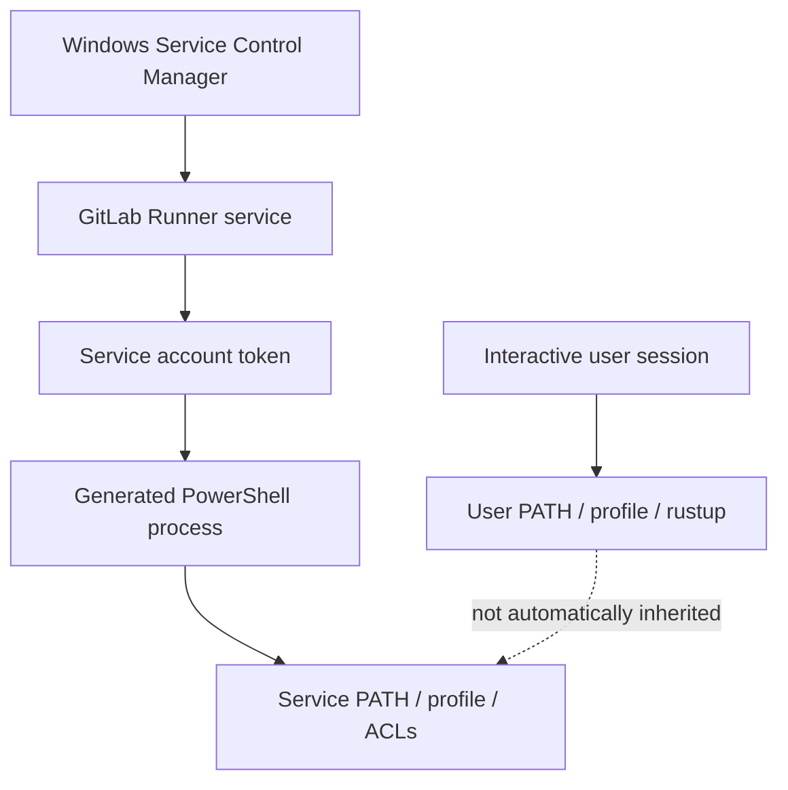

# Windows service identity and process execution

## The service account is the effective user

An interactive developer shell and a Windows service often run under different identities. The developer may have Rust installed through `rustup` in a personal profile, custom PATH entries, proxy settings and certificate stores. The GitLab Runner service may run as Local System or a dedicated service account with a different environment. Consequently `cargo --version` can work in a console yet fail in CI.



## Service lifecycle

Windows Service Control Manager starts the runner executable as a service. The runner reads its configuration and connects to GitLab. When assigned a Shell job, it creates a process to execute the generated script. The resulting process normally inherits the service account's security context and environment, subject to runner configuration.

A service account needs permission to log on as a service and access to its working directories, executable, configuration, Git, Cargo and approved scanners. A dedicated least-privilege identity is generally preferable to a highly privileged shared account.

## Profile and PATH mismatch

The user-specific Cargo binary directory is often under `%USERPROFILE%\.cargo\bin`. If Rust was installed only for the developer, the runner's account may not see it. The fix is not necessarily to prepend a developer's home directory to PATH. Instead, establish a managed toolchain location or explicitly provision the service identity.

```powershell
Write-Host "Identity: $([Security.Principal.WindowsIdentity]::GetCurrent().Name)"
Write-Host "Project: $env:CI_PROJECT_DIR"
Write-Host "Cargo home: $env:CARGO_HOME"
Get-Command cargo -ErrorAction SilentlyContinue
where.exe cargo
```

These are diagnostic examples, not a complete security audit. Do not print credentials or dump all environment variables into CI logs.

## Filesystem access

Windows ACLs govern access to build directories, cache paths, certificate files and tools. A job that can read source files may still be unable to write `target/`, create a cache archive or access a certificate private key. Review both NTFS permissions and network-share permissions where relevant.

## Process persistence

Shell jobs execute on a persistent host. Processes, temp files and global tool state may outlive an individual job if cleanup fails. A shared host can expose other jobs' files or secrets if permissions are weak. Prefer dedicated VMs and avoid mixing trusted release jobs with untrusted merge requests.

## Operational checks

Use the Services console or `Get-Service` to inspect service status. For root cause, correlate service logs, runner job traces, Windows Event Viewer and the effective service account. `gitlab-runner verify` checks runner connectivity/registration status; it does **not** prove that Cargo, Git, PowerShell or scanners will execute correctly.

**Conclusion:** A Windows runner must be assessed in the service context, not only from the administrator's desktop session.
