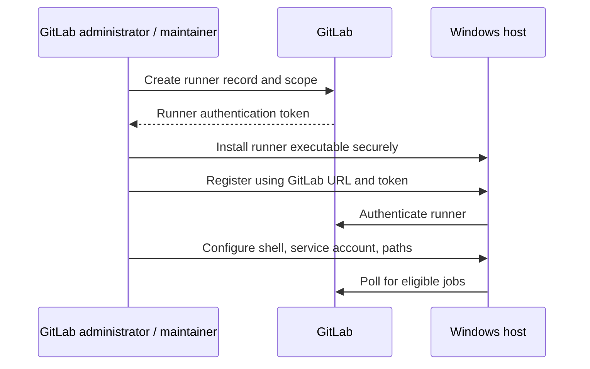

# Installation, registration and configuration boundaries

## Installation is a host operation; registration is a GitLab relationship

Installing GitLab Runner places the executable on a Windows host and configures it to run. Creating a runner in GitLab establishes the runner record and its scope. Registration connects the local installation to that record. These are distinct actions with distinct permissions and security consequences.

Modern GitLab versions use runner authentication tokens associated with runner creation workflows; older registration-token instructions may be deprecated or incompatible. Check the target GitLab and Runner versions before following a guide.

## Conceptual setup sequence



The precise UI location and role requirements vary by runner scope and GitLab release. Project runner creation typically requires Maintainer-level authority; instance runners are administered at instance level. Never paste a real runner authentication token into documentation or a job log.

## Installation review

A production-grade Windows runner should have a dedicated host or VM, controlled administrator access, pinned Runner version, managed Git and Rust toolchains, approved network egress and a documented service account. Store the runner executable and `config.toml` where ordinary CI jobs cannot modify them.

Illustrative commands often encountered in Windows setup guides:

```powershell
# Illustrative only: review service account and installation policy first
.\gitlab-runner.exe --version
.\gitlab-runner.exe register
.\gitlab-runner.exe install
.\gitlab-runner.exe start
```

Registration prompts and command flags vary across releases. Service installation can require elevated permissions. These examples are **not** a request to execute them now; the present phase is documentation-only.

## The local configuration file

`config.toml` defines local runner settings, including the executor, shell, build directories, and concurrency limits. It is not committed to the application's repository because it may contain sensitive runner authentication material. Distinguish runner configuration from `.gitlab-ci.yml`, which belongs to the project and defines jobs.

## Version compatibility

Runner and GitLab versions should be supported together. Upgrade planning should include release notes, service restart implications, executor behavior and any changes to registration workflows. Do not assume an old blog post accurately describes a current GitLab instance.

## Offline validation exercise

Given a diagram showing one GitLab group, two projects and one Windows VM, decide whether to use a project or group runner, identify the administrator for each side, and state how you would protect the runner authentication token. Explain why successful registration does not validate the Rust toolchain.

**Conclusion:** Registration answers *who the runner is to GitLab*; Windows configuration answers *how jobs will execute*.
