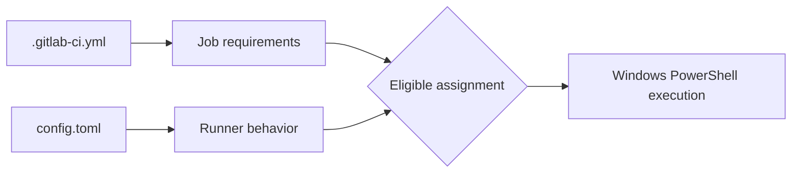

# `config.toml`: runner-side execution policy

## Two configuration planes

Project `.gitlab-ci.yml` describes jobs. Runner `config.toml` describes the worker's local behavior. A YAML author can request `tags: [windows]`, but cannot legitimately choose the runner service account, modify its executor or change its filesystem permissions from the project file.

## Annotated example

```toml
concurrent = 2
check_interval = 0

[[runners]]
  name = "win-rust-shell-01"
  url = "https://gitlab.example.invalid"
  executor = "shell"
  shell = "pwsh"
  limit = 1
  builds_dir = "D:/gitlab-runner/builds"
  cache_dir = "D:/gitlab-runner/cache"
  # token is intentionally omitted from this example
```

The URL is a non-routable placeholder. Real runner authentication tokens must be protected. Paths must exist or be creatable by the service identity. This example illustrates configuration boundaries, not a universally optimal production setup.

## Settings and effects

| Setting | Purpose | Common misunderstanding |
|---|---|---|
| `concurrent` | Global job concurrency for runner process | Not per-project concurrency |
| `[[runners]]` | One configured runner entry | Not a separate Windows identity |
| `executor` | Execution mechanism | Not selected by a job tag |
| `shell` | Generated script shell | Does not install `pwsh` |
| `limit` | Limit for this runner configuration | Not a GitLab user role |
| `builds_dir` | Local checkout/workspace root | Not artifact storage |
| `cache_dir` | Runner-local cache directory | Not necessarily distributed cache |

## Concurrency on a shared host

A high `concurrent` value can overload memory, CPU, disk and antivirus scanning. Multiple Rust builds can compete for disk I/O and compilation resources. Concurrency also increases collision risk for tools that write global state. Start with a conservative setting and measure actual workloads before increasing it.

## Configuration ownership and changes

Runner configuration is infrastructure configuration. Restrict modification rights, review changes and document restarts or reload behavior for the installed Runner version. Some settings are reread automatically, but do not assume every change takes effect instantly or without restarting the service.



## What belongs elsewhere?

GitLab project/group settings manage variables, permissions and runner assignment. Windows controls service identity and ACLs. Cargo config manages registries and build behavior. Proxy and CA configuration may be needed independently by GitLab Runner, Git, Cargo and scanners.

## Diagnostic reading

If a job log reports that `pwsh` cannot be found, inspect the configured shell and host installation. If jobs queue unexpectedly, inspect `concurrent`, `limit` and GitLab runner eligibility. If artifacts are missing, investigate job upload paths and GitLab artifact handling rather than changing `cache_dir`.

**Conclusion:** Read `config.toml` as the runner's execution contract, not as an extension of project YAML.
