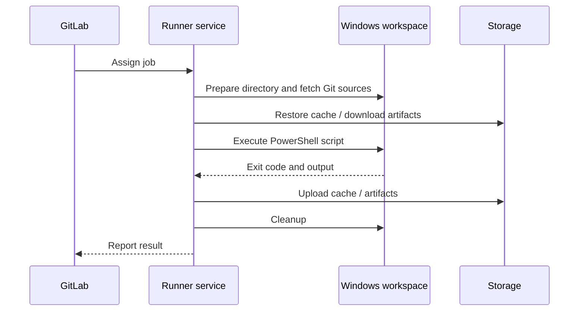

# Windows job execution and workspace lifecycle

## A job has several phases

A runner does more than invoke `cargo build`. It prepares directories, obtains repository sources, restores cache, retrieves upstream artifacts, executes generated scripts, uploads outputs and performs cleanup. Each phase can fail independently, and each has a different owner.



## Workspace identity

`CI_PROJECT_DIR` identifies the job's project directory. A Shell runner can reuse directories between jobs, but this is not a contract that files remain present. Git strategies, cleanup behavior and concurrent jobs influence the filesystem. Never use the host's persistent working directory as a substitute for GitLab artifacts.

## Data transfer boundaries

Cache restoration is best effort and primarily improves speed. Artifact download is a declared dependency on prior job outputs. `needs` changes execution order and can also control artifact retrieval. This distinction is critical when packaging a Rust executable built by another job.

```yaml
stages: [build, inspect]

build:
  stage: build
  tags: [windows, rust]
  script:
    - cargo build --release --locked
  artifacts:
    paths:
      - target/release/example.exe

inspect:
  stage: inspect
  tags: [windows, rust]
  needs:
    - job: build
      artifacts: true
  script:
    - 'if (-not (Test-Path "target/release/example.exe")) { throw "Artifact missing" }'
```

The executable name is illustrative. The path must match the actual Cargo package and target.

## Failure timing as evidence

| Failure point | First hypothesis |
|---|---|
| Pending job | No eligible runner / capacity |
| Source retrieval | Git credentials, TLS, network |
| Cache restore | Cache key/backend; usually nonfatal |
| Script start | PowerShell availability or account |
| Cargo compile | Toolchain, dependency, source |
| Artifact upload | Path, file creation, permissions |
| Cleanup | Locked files, lingering processes |

## Host persistence and contamination

Because the Shell executor runs directly on the host, processes and files may persist after job completion. Concurrent builds can compete for resources. If multiple trust levels share a host, project code may access data outside its own workspace if Windows ACLs permit it. The correct response is host isolation and least privilege, not merely more YAML cleanup commands.

## Java comparison

Maven's `target/` and Cargo's `target/` are build output directories. In both cases, a downstream job should consume a declared artifact rather than assuming the same host directory. The runner lifecycle is independent of which build tool produced the output.

**Conclusion:** Classify incidents by lifecycle phase before changing configuration.
