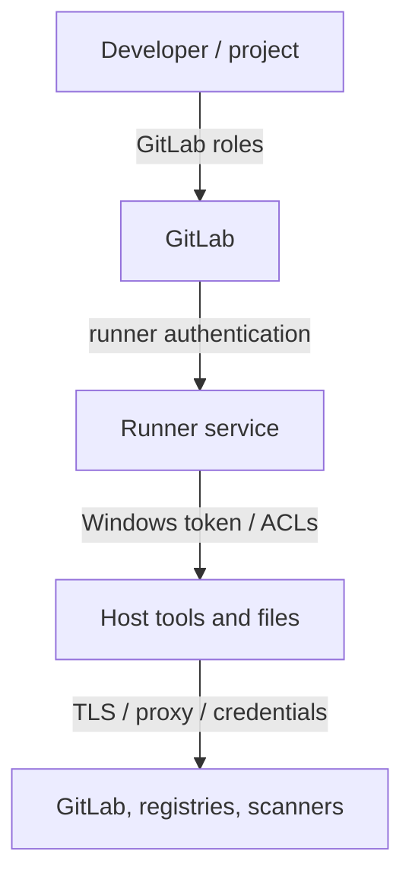

# Security, permissions, network and TLS

## Four distinct trust boundaries

A Windows runner crosses GitLab authorization, runner authentication, Windows operating-system permissions and network trust. A green runner status does not prove these boundaries are correctly configured.

## GitLab permissions

Project, group and instance runner scopes govern eligible projects. Protected runner settings can restrict jobs to appropriate protected refs, subject to GitLab configuration. CI/CD variables have their own protection and exposure rules. Review the combination: a job that can execute on a privileged host may be able to use host-level credentials even when GitLab variables are protected.

## Runner authentication and local secrets

Runner authentication tokens must be stored and rotated according to policy. Restrict access to `config.toml`, service configuration, logs and backup copies. Avoid placing registry tokens or scanner passwords in scripts, caches or artifacts. GitLab masked variables are helpful but are not a complete secret-management boundary against malicious job scripts.

## Windows account privileges

Prefer a dedicated low-privilege service identity. Grant only the ACLs required for builds and approved network access. Avoid local administrator rights unless justified by a documented requirement. Protect the runner executable, configuration, toolchain installations and build host against modification by untrusted jobs.

## TLS and proxy complexity

GitLab Runner, Git, Cargo, PowerShell web requests and security scanners may use different HTTP stacks and certificate stores. A certificate trusted by a browser is not necessarily trusted by every tool. Corporate TLS inspection can add custom root certificates, and proxies can differ by service account.

| Symptom | Likely area |
|---|---|
| Runner cannot contact GitLab | Runner URL, TLS, proxy, DNS |
| Checkout fails | Git TLS/credentials/proxy |
| Cargo dependency fetch fails | Cargo registry/network/certificates |
| Scanner upload fails | Scanner-specific trust/auth |
| Works interactively only | Service account environment |

## Threat model: untrusted merge requests

Shell execution gives repository code the service account's host privileges. Malicious code can inspect accessible files, modify writable tools or attempt network exfiltration. For this reason, shared Shell runners should not execute untrusted code from unrelated projects. Use separate VMs and strict project eligibility for sensitive workloads.

## Troubleshooting without leaking data

Collect sanitized error messages, tool versions, certificate issuer details and proxy configuration *names* rather than raw credentials. Do not disable TLS verification as a quick fix. Diagnose the exact client that fails and install approved trust roots through enterprise procedures.

**Conclusion:** Security depends on both scheduling permissions and host isolation; TLS diagnosis must be performed per tool.
