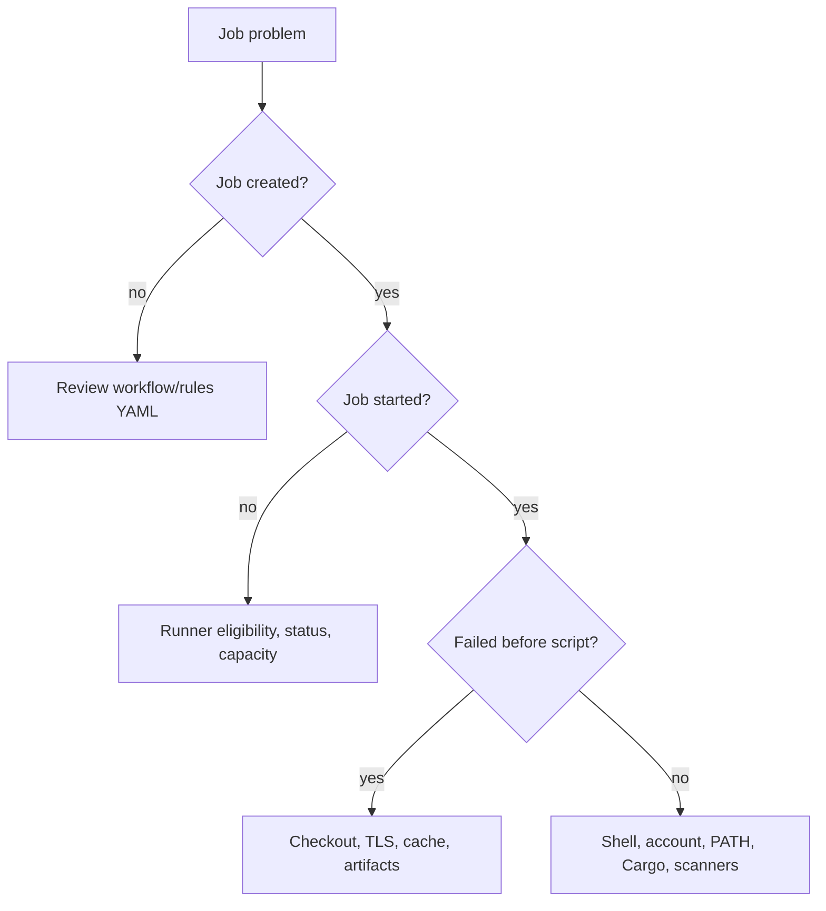

# Enterprise operations and troubleshooting

## Triage by layer, not by guesswork

Windows runner incidents span GitLab scheduling, runner connectivity, service identity, PowerShell, Cargo, filesystem and network. A good investigation first identifies where the lifecycle stopped, then collects evidence from that layer.

## Diagnostic matrix

| Symptom | Evidence | First check |
|---|---|---|
| Job pending | Job details, runner tags | Matching eligible runner |
| Runner offline | Service status, runner logs | Service and GitLab connectivity |
| `cargo` not found | `Get-Command`, PATH | Service account toolchain |
| Access denied | Windows error, target path | NTFS ACL / service identity |
| Checkout TLS failure | Git error | Git certificate/proxy config |
| Cache miss on one host | Runner identity, cache log | Local versus distributed cache |
| Scanner upload 401 | Sanitized response | Token scope and scanner config |
| Native tool returns nonzero | `$LASTEXITCODE` | Tool error and command arguments |

## Example: Cargo works locally but fails in CI

A developer's console finds `cargo.exe`; the CI job reports command not found. The runner is online and job execution has started, so scheduling is not the problem. Determine the service account, inspect its PATH and Cargo installation, and compare with the interactive user's profile. Fix the managed toolchain or service environment rather than adding arbitrary developer-profile paths.

## Example: runner online, job pending

Inspect job tags and runner tags, scope, protected-ref restrictions, paused state and concurrency. Runner connectivity alone is insufficient: an online runner can be ineligible for a particular job.

## Example: certificate errors in only one tool

If Git checkout succeeds but Cargo fetch fails, do not conclude the runner's TLS is universally correct. Each tool may use different proxy settings or trust stores. Capture the exact endpoint and client error. Do not disable verification; correct the approved certificate/proxy configuration for that client.

## Operational baseline

Maintain a documented owner, supported runner version, service account, toolchain inventory, capacity limits, storage paths, certificate/proxy configuration, secret rotation plan and patching process. Restrict interactive login and administrator access. Monitor queue times, disk usage, job failures and service restarts.

## Evidence hygiene

CI logs can expose paths, internal URLs, usernames and sensitive values. Sanitize before sharing. Prefer short diagnostic commands over full environment dumps. Record changes to runner infrastructure separately from changes to project YAML.

## Offline incident exercise

Given a trace with a successful checkout, a cache miss and `cargo : The term 'cargo' is not recognized`, identify the earliest fatal failure and list the minimum evidence needed. The cache miss is not the root cause; investigate the service account's executable lookup.

**Conclusion:** A reproducible triage method is more valuable than memorizing one-off fixes.
